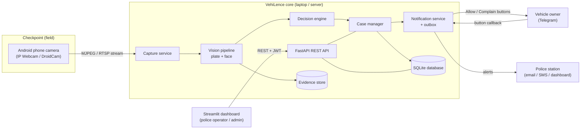
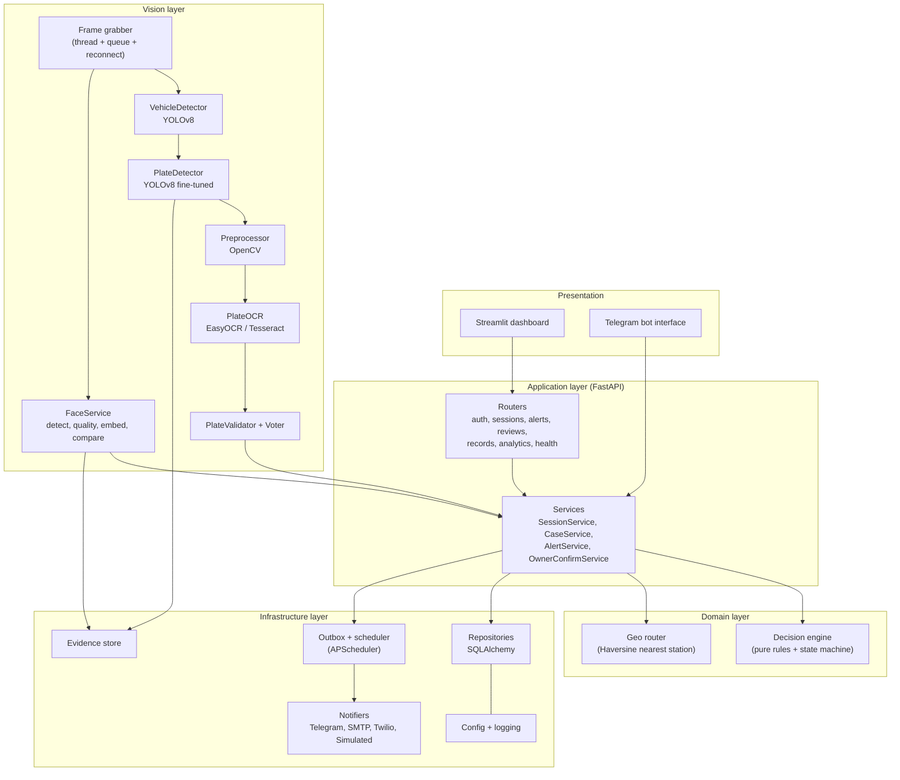
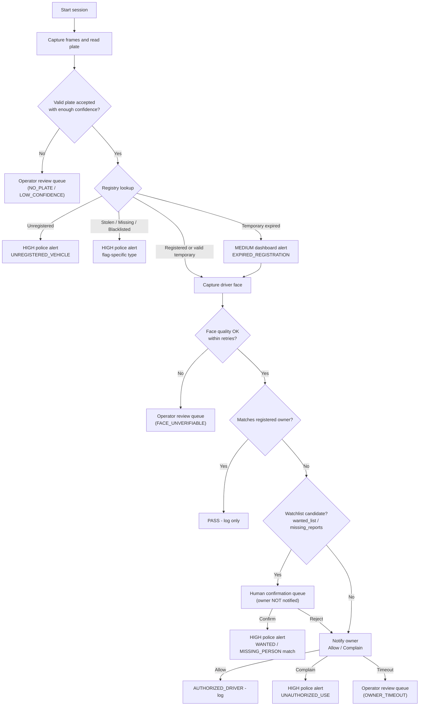
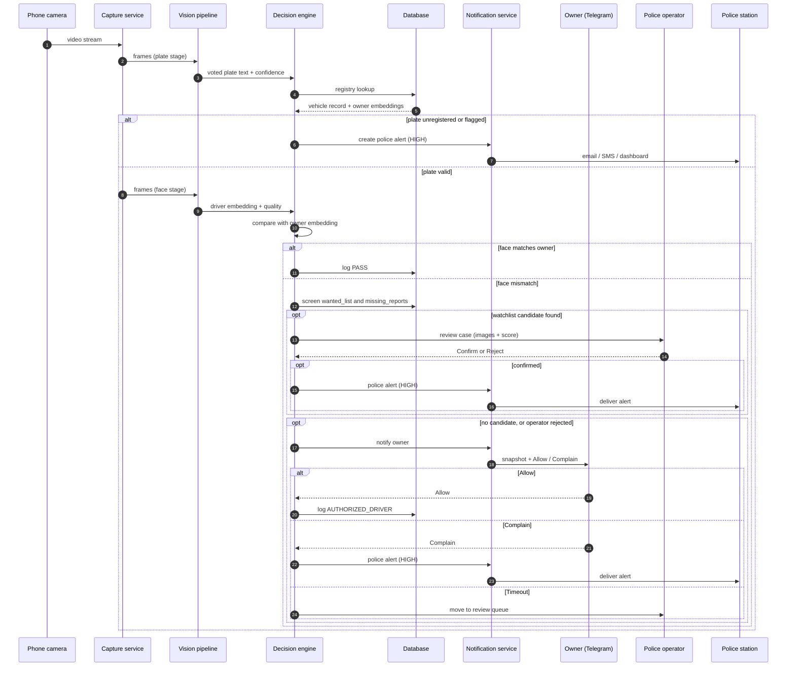
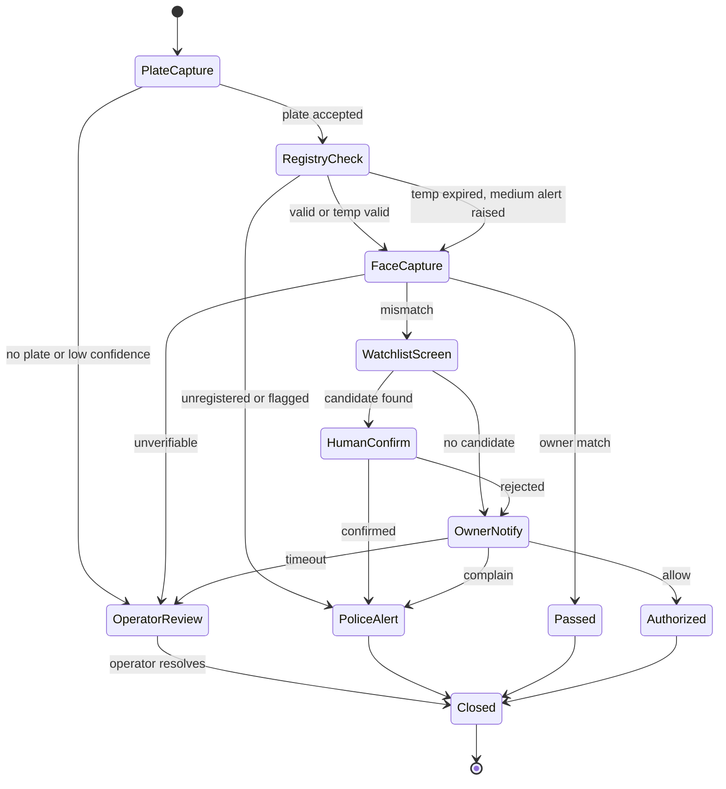
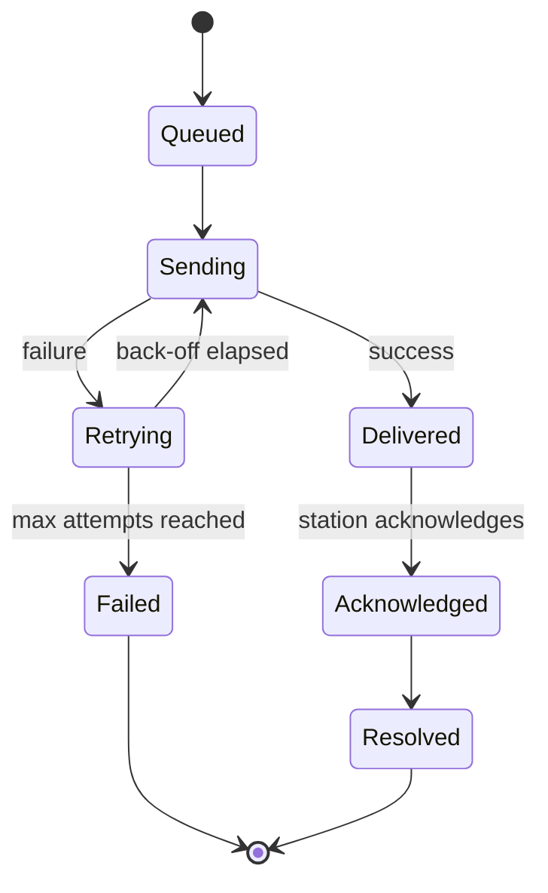
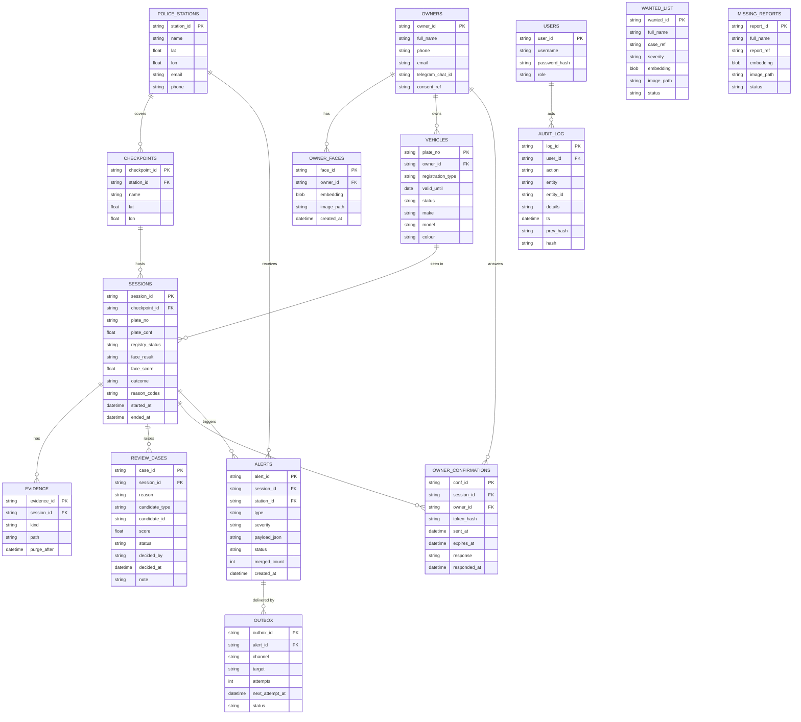
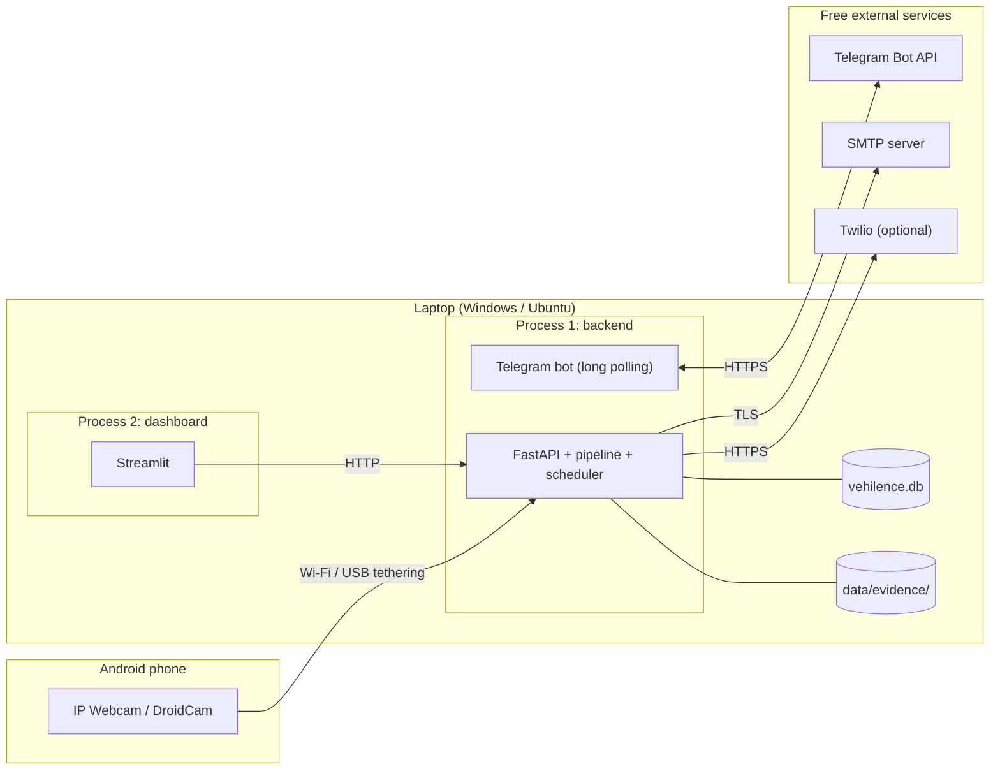

# System Architecture — VehiLence

| Field | Value |
|---|---|
| Document | `architecture.md` |
| Version | 1.0 (Draft for review) |
| Date | 04 Oct 2026 |
| Author | [Vinisha Marina Dsouza] |
| Related documents | [problem_statement.md](problem_statement.md) · [prd.md](prd.md) · [tech_stack.md](tech_stack.md) · [phase_definition.md](phase_definition.md) |

> Diagrams use [Mermaid](https://mermaid.js.org/). They render on GitHub, GitLab, VS Code (Markdown Preview Mermaid Support) and most Markdown viewers.

---

## 1. Architectural Overview

### 1.1 Style
VehiLence is a **modular monolith** with a separate dashboard:

- One **Python backend** (FastAPI) that hosts the capture worker, vision pipeline, decision engine, case manager, notification service and REST API as clearly separated modules.
- One **Streamlit dashboard** that talks to the backend only through the REST API.
- One **SQLite database** and a local **evidence store**.
- External services: **phone camera stream**, **Telegram**, **SMTP/Twilio**.

A microservice split would add deployment complexity with no benefit for a single-laptop prototype. Module boundaries are kept strict so any module can later be extracted.

### 1.2 Design principles

| Principle | Meaning in this system |
|---|---|
| **Safety first** | `UNVERIFIABLE`, `NO_PLATE`, timeouts → review, never pass, never auto-alert |
| **Human in the loop** | No watchlist-based police dispatch without a recorded human decision |
| **Deterministic decisions** | The decision engine is a pure function of inputs + config; easy to test and audit |
| **Explainability** | Every outcome stores reason codes, scores and thresholds |
| **Fail-soft integrations** | External service failure never blocks detection (outbox + retry) |
| **Config over code** | Thresholds, timeouts, scope and patterns live in configuration |
| **Replaceable parts** | Interfaces for face model, OCR, storage and notifiers |

## 2. System Context



## 3. Component Architecture



### 3.1 Module responsibilities

| Module | Responsibility | Key PRD refs |
|---|---|---|
| **Frame grabber** | Reads the phone stream in its own thread, keeps the latest frames in a bounded queue, reconnects on failure | FR-CAP-01, 02, 06 |
| **VehicleDetector** | Detects vehicle boxes (COCO classes) | FR-PLT-01 |
| **PlateDetector** | Localises and crops the plate | FR-PLT-02 |
| **Preprocessor** | Grayscale, denoise, CLAHE, deskew | FR-PLT-03 |
| **PlateOCR** | EasyOCR primary, Tesseract fallback; returns text + confidence | FR-PLT-04 |
| **PlateValidator + Voter** | Normalise, position-aware correction, regex validation, majority vote over N frames | FR-PLT-05, 06, 08 |
| **FaceService** | Face detection, quality gate, embedding, 1:1 and 1:N comparison | FR-FACE-*, FR-WL-* |
| **Decision engine** | Applies the PRD §5 matrix; emits outcome + reason codes + required actions | FR-REG, FR-WL, FR-OWN |
| **Case manager** | Owns session, review-case and owner-confirmation state; enforces state transitions | FR-HC-*, FR-OWN-* |
| **Geo router** | Maps checkpoint → nearest police station | FR-GEO-* |
| **Alert service** | Builds alert payloads, de-duplicates, writes to the outbox | FR-ALR-* |
| **Notification service** | Delivers via Telegram, SMTP, Twilio or simulated inbox; retries | FR-ALR-03, 04, 06 |
| **Scheduler** | Owner timeouts, outbox retry, retention purge, review SLA flags | FR-OWN-05, FR-ALR-04, FR-ADM-04 |
| **REST API** | Auth, CRUD, queues, analytics, health | FR-DSH, FR-ADM, FR-AUTH |
| **Dashboard** | Operator and admin UI | FR-DSH-* |

## 4. Core Decision Flow

This is the authoritative flow; it implements the matrix in [prd.md §5](prd.md).



## 5. Runtime Sequence



## 6. State Machines

### 6.1 Session lifecycle



### 6.2 Alert delivery lifecycle



### 6.3 Review case lifecycle

| State | Meaning | Allowed next states |
|---|---|---|
| `PENDING` | Waiting for a human decision | `CONFIRMED`, `REJECTED`, `ESCALATED` |
| `CONFIRMED` | Operator confirms the match / issue | terminal (alert dispatched) |
| `REJECTED` | Operator rejects the match | terminal (flow continues to owner notification where applicable) |
| `ESCALATED` | Needs senior review | `CONFIRMED`, `REJECTED` |

There is **no transition from `PENDING` to dispatch without a human action**.

## 7. Data Architecture

### 7.1 Entity-relationship diagram



> `REVIEW_CASES.candidate_type` / `candidate_id` point to either `WANTED_LIST` or `MISSING_REPORTS` (polymorphic reference, intentionally without a database foreign key). `wanted_list` and `missing_reports` are standalone tables searched by embedding.

### 7.2 Data handling rules

| Data | Stored as | Retention | Access |
|---|---|---|---|
| Face embeddings | `float32` BLOB (512-d) | Until the record is removed | Backend only |
| Evidence images (plate crop, vehicle frame, driver snapshot) | Files in the evidence store, path in DB | Default 30 days, then purged | Authenticated API, role-limited |
| Session logs and scores | Database rows | Kept for evaluation | Operators, admins, viewers |
| Audit log | Append-only table, optional hash chain (`hash = H(prev_hash + record)`) | Kept | Admin, viewer (read-only) |
| Owner tokens | Hash only (`token_hash`) | Until expiry | Backend only |
| Secrets | Environment variables / `.env` | — | Never in the repository |

## 8. Key Algorithms

### 8.1 Plate recognition and acceptance

1. Detect vehicle boxes, then the plate within the vehicle region.
2. Crop with a margin, preprocess, run OCR.
3. Normalise text: uppercase, strip separators.
4. Apply position-aware correction according to the pattern (digit slots: `O→0`, `I→1`, `B→8`, `S→5`; letter slots: reverse).
5. Validate against the configured patterns; discard invalid strings.
6. Vote across the last *N* frames; accept only when a candidate has the majority and mean confidence ≥ `OCR_CONF_GATE`.
7. If nothing is accepted before `PLATE_TIMEOUT_S` → `NO_PLATE`.

### 8.2 Face verification (1:1)

1. Detect faces; select the driver (largest/most central).
2. Quality gate (size, sharpness, brightness, pose). Fail → retry up to `FACE_RETRIES`, then `UNVERIFIABLE`.
3. Compute the embedding.
4. Compute cosine distance to each stored owner embedding; take the minimum.
5. `distance ≤ FACE_THRESHOLD_OWNER` → `MATCH`, otherwise `MISMATCH`.

### 8.3 Watchlist screening (1:N)

1. Stack all `wanted_list` and `missing_reports` embeddings into a matrix.
2. Compute cosine similarity against the driver embedding.
3. Keep candidates within `FACE_THRESHOLD_WATCHLIST` (stricter than the owner threshold), top-K.
4. Any candidate → create a `PENDING` review case and **hold** the owner notification.

### 8.4 Nearest station

Haversine distance from the checkpoint coordinates to each station; choose the minimum. The result is cached per checkpoint.

### 8.5 Alert de-duplication

Key = `(plate_no, alert_type)`. If an open alert with the same key exists within `ALERT_COOLDOWN_S`, increment `merged_count` and append the new evidence instead of creating a new alert.

## 9. Configuration

All values live in `config/settings.yaml` (non-secret) and `.env` (secret).

| Key | Default | Purpose |
|---|---|---|
| `FRAME_FPS` | 8 | Processing frame rate |
| `PLATE_VOTE_FRAMES` | 10 | Frames in the voting window |
| `OCR_CONF_GATE` | 0.70 | Minimum mean OCR confidence to auto-accept a plate |
| `PLATE_TIMEOUT_S` | 10 | Time before `NO_PLATE` |
| `FACE_RETRIES` | 3 | Recapture attempts |
| `FACE_THRESHOLD_OWNER` | tuned | Owner-match distance threshold |
| `FACE_THRESHOLD_WATCHLIST` | stricter than owner | Watchlist threshold |
| `WATCHLIST_SCOPE` | `mismatch_only` | or `all_faces` (decision D-02) |
| `WATCHLIST_TOP_K` | 3 | Candidates shown to the operator |
| `OWNER_TIMEOUT_S` | 600 (demo: 120) | Owner response window |
| `ALERT_COOLDOWN_S` | 900 | De-duplication window |
| `OUTBOX_MAX_ATTEMPTS` | 5 | Delivery attempts |
| `EVIDENCE_RETENTION_DAYS` | 30 | Purge window |
| `ALERT_MODE` | `simulated` | `simulated` or `live` |

## 10. REST API Overview

Base path `/api/v1`. All endpoints except `/auth/login` and `/health` require a JWT. Full schema is generated automatically at `/docs` (OpenAPI).

| Method | Path | Purpose | Roles |
|---|---|---|---|
| POST | `/auth/login` | Obtain access token | all |
| GET | `/health` | Component status | public |
| POST | `/sessions` | Start a capture session | Checkpoint Op, Admin |
| POST | `/sessions/{id}/face-capture` | Trigger Stage B | Checkpoint Op |
| POST | `/sessions/{id}/stop` | End session | Checkpoint Op |
| GET | `/sessions`, `/sessions/{id}` | List / detail with evidence and scores | Operators, Admin, Viewer |
| GET | `/alerts` | List with filters | Operators, Admin, Viewer |
| POST | `/alerts/{id}/ack` | Station acknowledgement | Police Op |
| GET | `/reviews` | Review queue | Police Op, Admin |
| POST | `/reviews/{id}/decision` | Confirm / Reject with note | Police Op |
| POST | `/owner-confirmations/{token}/respond` | Signed-link fallback for Allow / Complain | public (token-protected) |
| GET/POST/PUT/DELETE | `/vehicles`, `/owners`, `/wanted`, `/missing-reports`, `/stations`, `/checkpoints` | Record management (including face enrolment) | Admin |
| GET | `/analytics/summary` | Charts data | Operators, Admin, Viewer |
| GET | `/audit` | Audit log | Admin, Viewer |

## 11. Security Architecture

| Concern | Control |
|---|---|
| Authentication | JWT bearer tokens; bcrypt password hashes; short token lifetime |
| Authorisation | Role checks in API dependencies (Admin / Police Operator / Checkpoint Operator / Viewer) |
| Owner response integrity | Telegram callbacks verified against the stored chat ID; fallback links use signed, single-use, expiring tokens (hash stored) |
| Data at rest | Embeddings and evidence not served publicly; OS-level disk encryption recommended on the demo laptop |
| Data in transit | HTTPS for anything beyond the local network; Telegram and SMTP use TLS |
| Secrets | `.env` excluded from Git; rotated before sharing the repository |
| Input handling | Pydantic validation, file-type and size checks on uploads |
| Abuse resistance | Rate limiting on public endpoints; single-response idempotency for owner actions |
| Accountability | Append-only audit log; every human decision records actor, time and note |
| Supply chain | `pip-audit`; pinned dependency versions |

## 12. Reliability and Error Handling

| Failure | Behaviour |
|---|---|
| Phone stream drops | Frame grabber reconnects; session pauses; warning on the dashboard |
| OCR gives invalid/low-confidence text | Counts as no acceptance; after timeout → `NO_PLATE` review |
| Face not usable | Retry up to `FACE_RETRIES`, then `UNVERIFIABLE` review |
| Telegram / SMTP / Twilio failure | Message stays in the outbox; retried with back-off; `FAILED` is shown prominently after the last attempt |
| Backend restart mid-session | Open sessions and owner confirmations are reloaded from the database; the timeout scheduler resumes |
| Duplicate owner response | First response wins; others are logged and ignored |
| Database write error | Transaction rolled back; session marked `ERROR` with reason code |

## 13. Deployment View



- **Dev / demo:** both processes run on one laptop; the phone joins the same network.
- **Optional Docker:** one container for the backend, one for the dashboard, a mounted volume for the database and evidence.
- **Telegram long polling** removes the need for a public URL or tunnel.

## 14. Proposed Repository Structure

```text
vehilence/
├── app/
│   ├── main.py                    # FastAPI entry point
│   ├── api/                       # routers: auth, sessions, alerts, reviews, records, analytics
│   ├── core/                      # config, security, logging, scheduler
│   ├── domain/
│   │   ├── decision_engine.py     # pure rules (PRD §5 matrix)
│   │   ├── states.py              # enums: outcomes, statuses, reason codes
│   │   └── geo.py                 # Haversine nearest-station
│   ├── pipeline/
│   │   ├── capture.py             # frame grabber
│   │   ├── vehicle_detector.py
│   │   ├── plate_detector.py
│   │   ├── preprocess.py
│   │   ├── ocr.py
│   │   ├── plate_validator.py     # normalise, correct, regex, voting
│   │   ├── face_service.py        # detect, quality, embed, compare
│   │   └── run.py                 # pipeline runner
│   ├── services/                  # session, case, alert, owner-confirm
│   ├── notifiers/                 # telegram.py, smtp.py, twilio.py, simulated.py
│   ├── db/                        # models.py, repositories.py, migrations/
│   └── schemas/                   # Pydantic request/response models
├── dashboard/
│   ├── Home.py
│   └── pages/                     # Live, Alerts, Review, Search, Analytics, Admin, Audit
├── config/
│   ├── settings.yaml
│   └── plate_patterns.yaml
├── scripts/
│   ├── seed_data.py               # builds dummy DB reproducibly
│   ├── train_plate_detector.ipynb
│   └── evaluate.py                # metrics for the report
├── data/
│   ├── evidence/                  # runtime evidence (git-ignored)
│   ├── test_plates/               # held-out test images
│   └── test_sessions/             # recorded sessions for replay
├── tests/
│   ├── unit/                      # decision engine, validator, geo, thresholds
│   ├── integration/               # API + DB + notifier (mocked)
│   └── scenarios/                 # S01–S18 from the PRD
├── docs/                          # these documents + datasets.md + consent templates
├── .env.example
├── requirements.txt
└── README.md
```

## 15. Concurrency Model

- **Frame grabber thread** → bounded queue (drops old frames to stay real-time).
- **Pipeline worker** consumes frames, runs detection/OCR/face on the newest frames, and calls the decision engine.
- **FastAPI event loop** serves REST requests; heavy model inference runs outside the request path.
- **Scheduler thread** handles timeouts, retries and purges.
- **Models are loaded once** at start-up and reused (avoids repeated multi-second loads).
- SQLite runs in WAL mode so the dashboard can read while the pipeline writes.

## 16. Observability

- Structured logs (JSON or key-value) with `session_id` on every line.
- Per-stage timings stored on each session: capture, detect, OCR, face, decision, total.
- Dashboard "System health" panel using `/health` (models loaded, DB reachable, stream alive, notifier status, outbox backlog).
- Evaluation script reads the sessions table to produce report-ready metrics.

## 17. Architecture Decisions (Summary)

| ID | Decision | Alternatives | Rationale |
|---|---|---|---|
| ADR-01 | Modular monolith | Microservices | Single-laptop prototype; simpler to build and demo |
| ADR-02 | FastAPI | Flask | Typed models, auto docs, auth helpers |
| ADR-03 | SQLite (WAL) | PostgreSQL | Zero setup; matches the report; swap path documented |
| ADR-04 | Streamlit dashboard | React / plain HTML | Speed; Python-only |
| ADR-05 | Telegram for owner actions | SMS / FCM | Free, buttons and photos without an app |
| ADR-06 | Outbox pattern for alerts | Direct send | No lost alerts; external failures isolated |
| ADR-07 | Human confirmation for watchlist | Auto-dispatch | Safety, ethics, legal defensibility |
| ADR-08 | `UNVERIFIABLE` as a distinct state | Treat as mismatch | Prevents false accusations on poor images |
| ADR-09 | Pure-function decision engine | Logic spread across modules | Testable; auditable; deterministic |
| ADR-10 | Cosine search with NumPy | FAISS | Watchlist is tiny; FAISS stays as an upgrade |
| ADR-11 | Embeddings stored, images purged | Keep all images | Data minimisation |
| ADR-12 | Config-driven thresholds | Hard-coded | Tuning on own data; easy experiments |

## 18. Extension Points

| Future need | Where it plugs in |
|---|---|
| CCTV / RTSP cameras | Frame grabber input |
| Multi-camera tracking | New `tracking` module consuming `sessions` |
| Liveness detection | `FaceService.quality_and_liveness()` |
| Make / model / colour clone check | New check in the decision engine using `VEHICLES.make/model/colour` |
| Real registry integration (Vahan / CCTNS) | Repository interface for vehicles, behind authorisation |
| Mobile app for owners | New notifier + owner API |
| PostgreSQL + FAISS | Repository layer and `FaceService` index |
| Edge deployment | Package the pipeline separately from API/dashboard |

## 19. Revision History

| Version | Date | Change |
|---|---|---|
| 1.0 | 04 Oct 2026 | Initial architecture |
