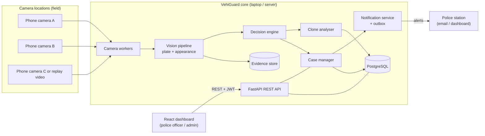
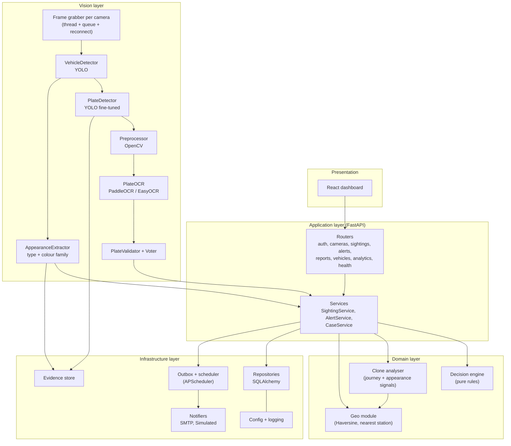
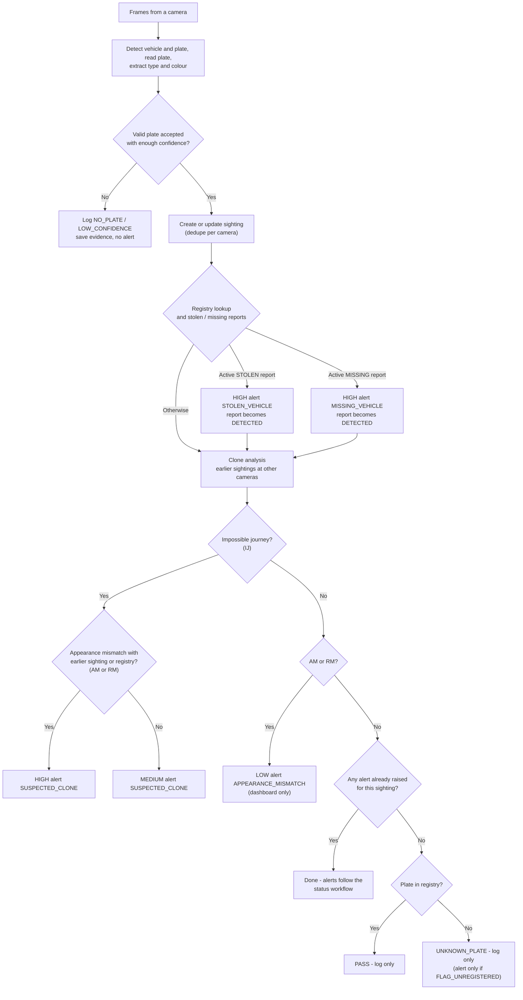
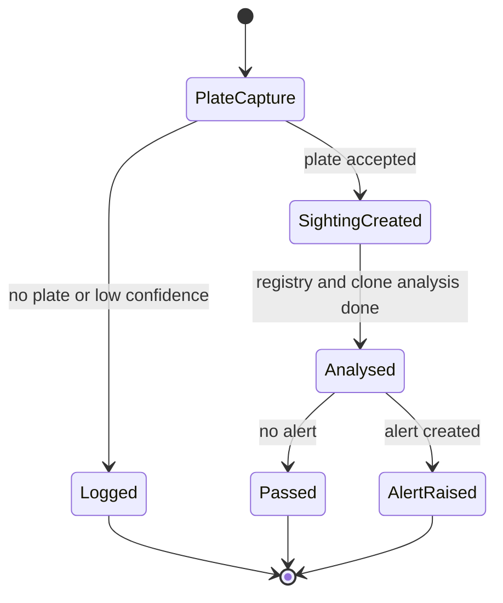
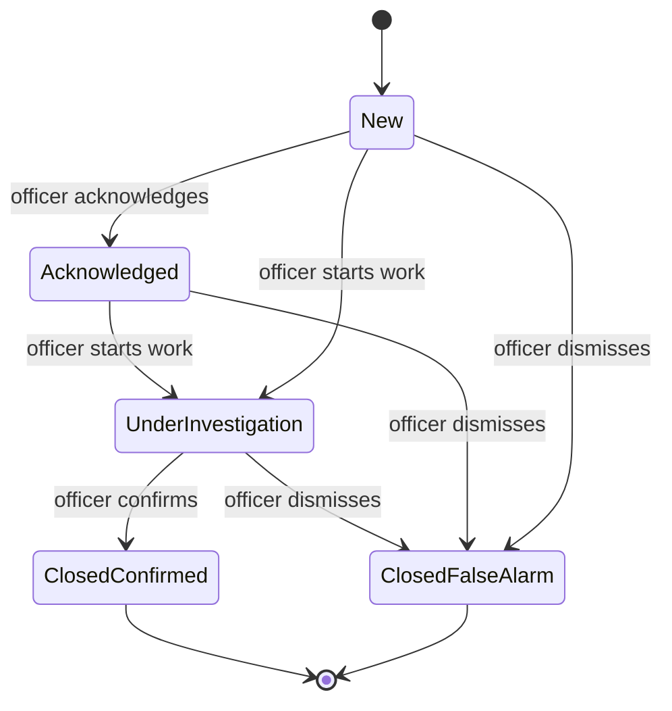
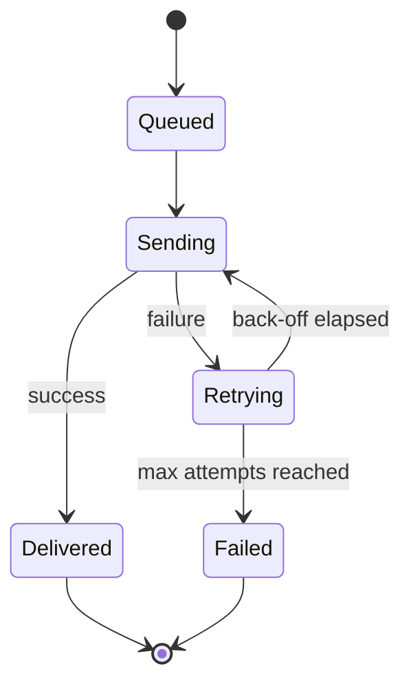
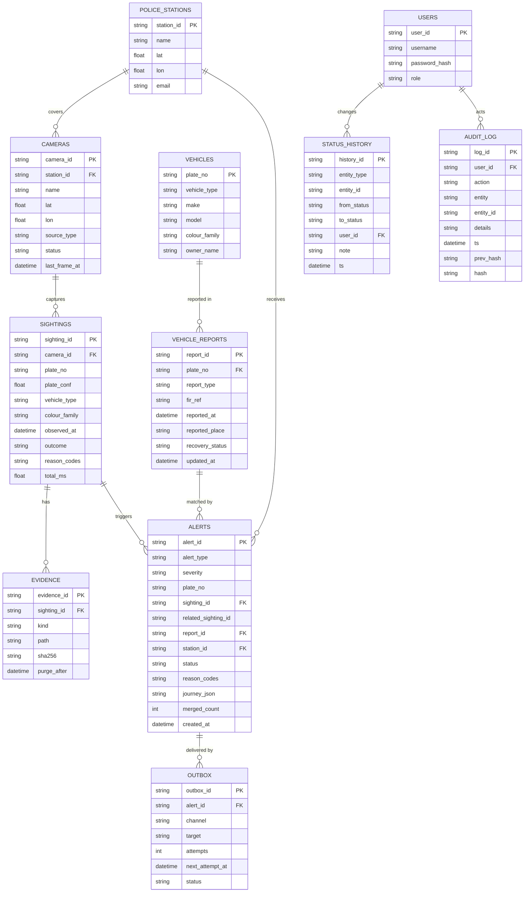
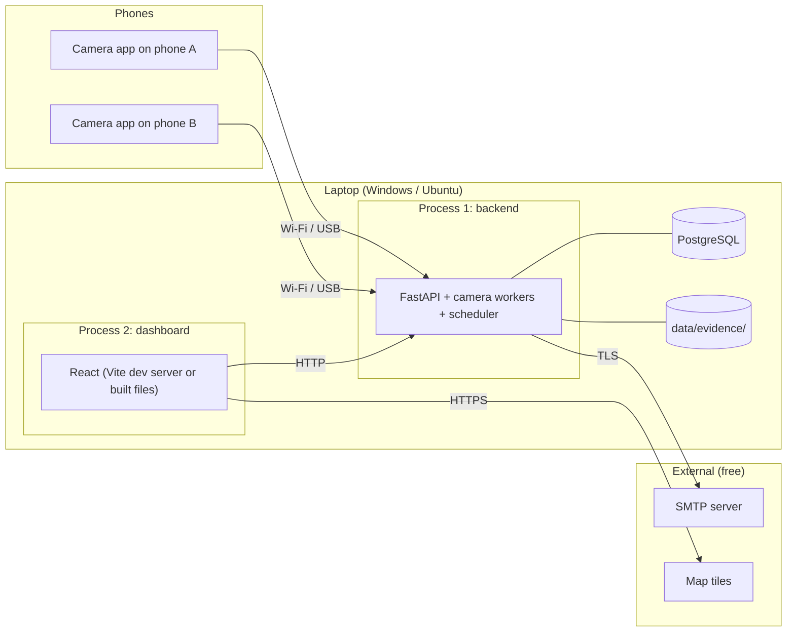

# System Architecture — VehiGuard

| Field | Value |
|---|---|
| Document | `architecture.md` |
| Version | 2.0 (Draft for review) |
| Date | 09 Nov 2026 |
| Author | [Vinisha Marina Dsouza] |
| Related documents | [problem_statement.md](problem_statement.md) · [prd.md](prd.md) · [tech_stack.md](tech_stack.md) · [phase_definition.md](phase_definition.md) |

> Diagrams use [Mermaid](https://mermaid.js.org/). They render on GitHub, GitLab, VS Code (Markdown Preview Mermaid Support) and most Markdown viewers.

---

## 1. Architectural Overview

### 1.1 Style
VehiGuard is a **modular monolith** with a separate React dashboard:

- One **Python backend** (FastAPI) that hosts the camera workers, vision pipeline, decision engine, clone analyser, case manager, notification service and REST API as clearly separated modules.
- One **React dashboard** that talks to the backend only through the REST API.
- One **PostgreSQL database** and a local **evidence store**.
- External inputs and services: **phone camera streams** and **SMTP**.

A microservice split would add deployment complexity with no benefit for a single-laptop prototype. Module boundaries are kept strict so any module can later be extracted.

### 1.2 Design principles

| Principle | Meaning in this system |
|---|---|
| **Safety first** | `NO_PLATE`, `LOW_CONFIDENCE`, `UNKNOWN` appearance and fuzzy plate matches never create an automatic HIGH alert and never feed clone analysis |
| **Leads, not verdicts** | Alerts say "suspected"; a police officer verifies and decides |
| **Deterministic decisions** | The decision engine is a pure function of inputs + config; easy to test and audit |
| **Explainability** | Every outcome stores reason codes and the values behind them (distance, time gap, required speed, colours) |
| **Fail-soft integrations** | External service failure never blocks detection (outbox + retry) |
| **Config over code** | Thresholds, timeouts and patterns live in configuration |
| **Replaceable parts** | Interfaces for OCR, storage, distance calculation and notifiers |
| **Privacy by design** | No face recognition; evidence retention limits; role-based access |

## 2. System Context



## 3. Component Architecture



### 3.1 Module responsibilities

| Module | Responsibility | Key PRD refs |
|---|---|---|
| **Frame grabber** | Reads one camera's stream in its own thread, keeps the latest frames in a bounded queue, timestamps frames with the server clock, reconnects on failure | FR-CAP-01…07 |
| **VehicleDetector** | Detects vehicle boxes and classes (COCO classes) | FR-PLT-01 |
| **PlateDetector** | Localises and crops the plate | FR-PLT-02 |
| **Preprocessor** | Grayscale, denoise, CLAHE, deskew | FR-PLT-03 |
| **PlateOCR** | PaddleOCR primary, EasyOCR fallback; returns text + confidence | FR-PLT-04 |
| **PlateValidator + Voter** | Normalise, position-aware correction, regex validation, majority vote over N frames, `NO_PLATE` timeout | FR-PLT-05…07 |
| **AppearanceExtractor** | Vehicle type from the detector class; dominant colour family; majority over frames; `UNKNOWN` handling | FR-APP-01, 02, 05 |
| **SightingService** | Creates and de-duplicates sightings, saves evidence references | FR-SIG-*, FR-EVD-* |
| **Decision engine** | Applies the PRD §5 matrix; emits outcome, alert types, severities and reason codes | FR-REG-*, FR-CLN-04 |
| **Clone analyser** | Finds earlier sightings at other cameras, evaluates the impossible-journey rule and the appearance signals (IJ, AM, RM) | FR-CLN-01…03, 07; FR-APP-03, 04 |
| **Geo module** | Haversine distance; nearest station for a camera | FR-GEO-01, 02 |
| **Case manager** | Alert status workflow and recovery status transitions; status history | FR-ALR-07, FR-CASE-* |
| **Alert service** | Builds alert payloads, de-duplicates, writes to the outbox | FR-ALR-01, 02, 05 |
| **Notification service** | Delivers via SMTP or the simulated inbox; retries | FR-ALR-03, 04, 06 |
| **Scheduler** | Outbox retry, evidence retention purge, camera health | FR-ALR-04, FR-EVD-03, FR-CAP-07 |
| **REST API** | Auth, CRUD, queues, analytics, health, live events | FR-DSH, FR-ADM, FR-AUTH |
| **Dashboard** | Officer and admin UI | FR-DSH-* |

## 4. Core Decision Flow

This is the authoritative flow; it implements the matrix in [prd.md §5](prd.md).



Alerts are delivered to the nearest station and then followed through the status workflow in §6.

## 5. Runtime Sequence

```mermaid
sequenceDiagram
  autonumber
  participant PH as Phone camera
  participant CAP as Camera worker
  participant VIS as Vision pipeline
  participant ENG as Decision engine
  participant CLN as Clone analyser
  participant DB as PostgreSQL
  participant NOT as Notification service
  participant OFF as Police officer
  participant POL as Police station

  PH->>CAP: video stream
  CAP->>VIS: frames with server timestamps
  VIS->>ENG: voted plate, confidence, type, colour, evidence
  ENG->>DB: save sighting
  ENG->>DB: registry and stolen/missing lookup
  DB-->>ENG: vehicle record and active reports

  opt stolen or missing match
    ENG->>NOT: HIGH alert
    NOT->>POL: email / dashboard
  end

  ENG->>CLN: analyse new sighting
  CLN->>DB: earlier sightings of this plate at other cameras
  DB-->>CLN: sightings with camera coordinates
  CLN->>CLN: distance, time gap, required speed, appearance
  CLN-->>ENG: IJ, AM, RM signals

  alt suspected clone or appearance mismatch
    ENG->>NOT: alert (HIGH / MEDIUM / LOW)
    NOT->>POL: deliver (LOW stays on dashboard)
  else no signals
    ENG->>DB: log PASS or UNKNOWN_PLATE
  end

  OFF->>DB: acknowledge, investigate, close or update recovery status
```

## 6. State Machines

### 6.1 Sighting lifecycle



### 6.2 Alert lifecycle (status workflow)



### 6.3 Recovery status of a stolen / missing report

| State | Meaning | Allowed next states |
|---|---|---|
| `REPORTED` | Report created; the vehicle has not been seen | `DETECTED`, `CLOSED` |
| `DETECTED` | The vehicle was detected by a camera (set automatically when an alert is created, FR-CASE-02) | `UNDER_INVESTIGATION`, `REPORTED` (false alarm), `RECOVERED`, `CLOSED` |
| `UNDER_INVESTIGATION` | Officers are acting on the detection | `RECOVERED`, `DETECTED`, `REPORTED`, `CLOSED` |
| `RECOVERED` | The vehicle has been recovered | `CLOSED` |
| `CLOSED` | Case ended (recovered and closed, withdrawn or duplicate) | terminal |

Reports in `REPORTED`, `DETECTED` or `UNDER_INVESTIGATION` are **active** and are matched against sightings. Reports in `RECOVERED` or `CLOSED` are not. Every transition stores the user, time, optional location and a note.

### 6.4 Alert delivery lifecycle



## 7. Data Architecture

### 7.1 Entity-relationship diagram



> `SIGHTINGS.plate_no` has **no foreign key** to `VEHICLES`, because unknown plates must also be stored and analysed. `ALERTS.related_sighting_id` points to the earlier sighting in a suspected clone (a second reference to `SIGHTINGS`, not drawn). `STATUS_HISTORY.entity_type` is `ALERT` or `REPORT`, and `entity_id` points to the matching table (polymorphic, no foreign key). `journey_json` holds from/to camera, distance, time gap and required speed.

### 7.2 Data handling rules

| Data | Stored as | Retention | Access |
|---|---|---|---|
| Sightings and decision logs | Database rows | Kept for evaluation | Officers, admins, viewers |
| Evidence images (vehicle frame, plate crop) | Files in the evidence store; path and SHA-256 in the database | Default 30 days, then purged, except for evidence linked to open alerts | Authenticated API, role-limited |
| Registry and reports (dummy) | Database rows | Until removed | Officers, admins |
| Status history | Append-only table | Kept | Officers, admins, viewers |
| Audit log | Append-only table, optional hash chain (`hash = H(prev_hash + record)`) | Kept | Admin, viewer (read-only) |
| Secrets | Environment variables / `.env` | — | Never in the repository |

No face data is detected, stored for matching or identified at any point.

## 8. Key Algorithms

### 8.1 Plate recognition and acceptance

1. Detect vehicle boxes, then the plate within the vehicle region.
2. Crop with a margin, preprocess, run OCR.
3. Normalise text: uppercase, strip separators.
4. Apply position-aware correction according to the pattern (digit slots: `O→0`, `I→1`, `B→8`, `S→5`; letter slots: reverse).
5. Validate against the configured patterns; discard invalid strings.
6. Vote across the last *N* frames; accept only when a candidate has the majority and mean confidence ≥ `OCR_CONF_GATE`.
7. If nothing is accepted before `PLATE_TIMEOUT_S` → `NO_PLATE` (logged, no alert).

### 8.2 Appearance extraction and comparison

1. **Type:** the detector class of the vehicle box; majority over the voting frames.
2. **Colour:** crop the body region of the vehicle (excluding the plate), convert to HSV, find the dominant colour, and map it to a colour family. Majority over the voting frames.
3. If the crop is too dark, too small or too blurred, the value is `UNKNOWN`.
4. **Compare** two appearance signatures: if either value is `UNKNOWN`, that attribute is skipped; if both are known and differ, the attribute is a mismatch.
5. **RM** compares the sighting with the registry record. **AM** compares the sighting with the earlier sighting.

### 8.3 Impossible-journey rule (clone analysis)

For a new sighting *s2* (camera B, time *t2*) of a plate with an earlier sighting *s1* (camera A, time *t1*) at a **different** camera within `CLONE_WINDOW_H`:

```text
d      = haversine(A.lat, A.lon, B.lat, B.lon)        # km
dt     = |t2 - t1|                                     # hours (server timestamps)
limit  = MAX_PLAUSIBLE_SPEED_KMH * (dt + TIME_TOLERANCE_S / 3600)
IJ     = (d >= MIN_CLONE_DISTANCE_KM) and (d > limit)
required_speed = d / dt                                # reported when dt > 0
```

The check uses a multiplication (no division), so a time gap of zero or near zero is handled. The tolerance and the straight-line distance both make the rule **conservative**: a possible journey is never flagged because of road shape or small timing errors.

**Worked example (with assigned coordinates):** Camera A and Camera B are registered 38 km apart. The plate is seen at A at 10:00:00 and at B at 10:06:00 (dt = 0.1 h, plus 5 s tolerance ≈ 0.1014 h). The limit is 120 × 0.1014 ≈ 12.2 km. Since 38 km > 12.2 km, the journey is impossible (required speed ≈ 380 km/h) → IJ is true.

If several earlier sightings exist, every one within the window is evaluated; the most recent one that gives IJ is used on the alert, and the others are listed in `journey_json`.

### 8.4 Nearest station

Haversine distance from the camera coordinates to each station; choose the minimum. The result is cached per camera.

### 8.5 Alert de-duplication

Key = `(plate_no, alert_type)`. If an open alert with the same key exists within `ALERT_COOLDOWN_S`, increment `merged_count` and append the new evidence instead of creating a new alert.

### 8.6 Recovery status

Transitions follow the table in §6.3. A stolen/missing alert sets `REPORTED → DETECTED` automatically; any other change requires an authorised user, a note, and creates a `STATUS_HISTORY` row.

## 9. Configuration

All values live in `config/settings.yaml` (non-secret) and `.env` (secret).

| Key | Default | Purpose |
|---|---|---|
| `FRAME_FPS` | 5 | Processing frame rate per camera |
| `PLATE_VOTE_FRAMES` | 10 | Frames in the voting window |
| `OCR_CONF_GATE` | 0.70 | Minimum mean OCR confidence to accept a plate |
| `PLATE_TIMEOUT_S` | 10 | Time before `NO_PLATE` |
| `FUZZY_MAX_EDIT_DISTANCE` | 1 | Edit distance for `POSSIBLE_MATCH` review items |
| `SIGHTING_COOLDOWN_S` | 30 | De-duplication window for sightings at one camera |
| `CLONE_WINDOW_H` | 24 | How far back to look for earlier sightings |
| `MAX_PLAUSIBLE_SPEED_KMH` | 120 | Impossible-journey speed limit (decision D-02) |
| `MIN_CLONE_DISTANCE_KM` | 1 | Ignore camera pairs closer than this |
| `TIME_TOLERANCE_S` | 5 | Added to the time gap to absorb stream delay |
| `FLAG_UNREGISTERED` | false | Alert on plates not in the registry (decision D-01) |
| `ALERT_COOLDOWN_S` | 900 | Alert de-duplication window |
| `OUTBOX_MAX_ATTEMPTS` | 5 | Delivery attempts |
| `EVIDENCE_RETENTION_DAYS` | 30 | Purge window (open cases excepted) |
| `ALERT_MODE` | `simulated` | `simulated` or `live` |

## 10. REST API Overview

Base path `/api/v1`. All endpoints except `/auth/login` and `/health` require a JWT. The full schema is generated automatically at `/docs` (OpenAPI).

| Method | Path | Purpose | Roles |
|---|---|---|---|
| POST | `/auth/login` | Obtain access token | all |
| GET | `/health` | Component status | public |
| GET/POST/PUT | `/cameras` | List, register and update cameras | Camera Operator, Admin |
| POST | `/cameras/{id}/start`, `/cameras/{id}/stop` | Start or stop a camera worker | Camera Operator, Admin |
| GET | `/sightings`, `/sightings/{id}` | List and detail with evidence and scores | Officer, Camera Operator, Admin, Viewer |
| GET | `/plates/{plate_no}/timeline` | Sightings of one plate across cameras | Officer, Admin, Viewer |
| GET | `/alerts`, `/alerts/{id}` | List with filters; detail | Officer, Admin, Viewer |
| POST | `/alerts/{id}/status` | Change alert status with a note | Officer |
| GET/POST | `/reports` | List stolen/missing reports; create a report | Officer, Admin (create); Viewer (list) |
| POST | `/reports/{id}/status` | Change recovery status with a note | Officer |
| GET/POST/PUT/DELETE | `/vehicles`, `/stations` | Record management | Admin |
| GET | `/review/possible-matches` | `POSSIBLE_MATCH` items | Officer |
| GET | `/analytics/summary` | Charts data | Officer, Admin, Viewer |
| GET | `/audit` | Audit log | Admin, Viewer |
| GET | `/events` | Server-Sent Events for live updates | all signed-in roles |

## 11. Security Architecture

| Concern | Control |
|---|---|
| Authentication | JWT bearer tokens; bcrypt password hashes; short token lifetime |
| Authorisation | Role checks in API dependencies (Admin / Police Officer / Camera Operator / Viewer) |
| Data at rest | Evidence not served publicly; OS-level disk encryption recommended on the demo laptop |
| Data in transit | HTTPS for anything beyond the local network; SMTP over TLS |
| Dashboard | CORS restricted to the dashboard origin; tokens never placed in URLs |
| Secrets | `.env` excluded from Git; rotated before sharing the repository |
| Input handling | Pydantic validation, file-type and size checks |
| Abuse resistance | Rate limiting on login |
| Evidence integrity | SHA-256 recorded when evidence is saved |
| Accountability | Append-only audit log; every human decision records actor, time and note |
| Supply chain | `pip-audit`, `npm audit`; pinned dependency versions |

## 12. Reliability and Error Handling

| Failure | Behaviour |
|---|---|
| A camera stream drops | That camera's frame grabber reconnects; its status shows offline; other cameras continue |
| OCR gives invalid or low-confidence text | Counts as no acceptance; after the timeout → `NO_PLATE` logged, no alert |
| Colour or type cannot be determined | Value `UNKNOWN`; never a mismatch |
| SMTP failure | Message stays in the outbox; retried with back-off; `FAILED` shown prominently after the last attempt |
| Backend restart | Cameras are restarted by the operator; open alerts and outbox entries are reloaded from the database; the scheduler resumes |
| Duplicate detections | Sighting and alert de-duplication |
| Database write error | Transaction rolled back; sighting marked `ERROR` with a reason code |

## 13. Deployment View



- **Dev / demo:** both processes and the database run on one laptop; the phones join the same network or connect by USB.
- **Replay mode:** a recorded video or image folder can replace any camera.
- **Optional Docker:** containers for the backend, dashboard and PostgreSQL, with mounted volumes for data and evidence.

## 14. Proposed Repository Structure

```text
vehiguard/
├── app/
│   ├── main.py                    # FastAPI entry point
│   ├── api/                       # routers: auth, cameras, sightings, alerts, reports, vehicles, analytics, events
│   ├── core/                      # config, security, logging, scheduler
│   ├── domain/
│   │   ├── decision_engine.py     # pure rules (PRD §5 matrix)
│   │   ├── clone_analyser.py      # impossible-journey and appearance signals
│   │   ├── states.py              # enums: outcomes, statuses, reason codes
│   │   └── geo.py                 # Haversine, nearest station
│   ├── pipeline/
│   │   ├── capture.py             # frame grabber per camera
│   │   ├── vehicle_detector.py
│   │   ├── plate_detector.py
│   │   ├── preprocess.py
│   │   ├── ocr.py                 # PaddleOCR with EasyOCR fallback
│   │   ├── plate_validator.py     # normalise, correct, regex, voting
│   │   ├── appearance.py          # vehicle type and colour family
│   │   └── run.py                 # pipeline runner (one camera per worker)
│   ├── services/                  # sighting, alert, case
│   ├── notifiers/                 # smtp.py, simulated.py
│   ├── db/                        # models.py, repositories.py, migrations/
│   └── schemas/                   # Pydantic request/response models
├── dashboard/                     # React (Vite) app
│   ├── src/
│   │   ├── pages/                 # Live, Alerts, AlertDetail, Plate, Reports, Review, Analytics, Admin, Audit
│   │   ├── components/            # maps, evidence viewer, badges
│   │   └── api/                   # API client
│   └── package.json
├── config/
│   ├── settings.yaml
│   └── plate_patterns.yaml
├── scripts/
│   ├── seed_data.py               # builds the dummy database reproducibly
│   ├── train_plate_detector.ipynb
│   └── evaluate.py                # metrics for the report
├── data/
│   ├── evidence/                  # runtime evidence (git-ignored)
│   ├── test_plates/               # held-out test images
│   ├── test_vehicles/             # labelled vehicle crops for appearance tests
│   └── test_sessions/             # recorded sessions for replay (scenarios S01–S17)
├── tests/
│   ├── unit/                      # decision engine, clone analyser, validator, geo, appearance
│   ├── integration/               # API + database + notifier (mocked)
│   └── scenarios/                 # S01–S17 from the PRD
├── docs/                          # these documents + datasets.md + consent form
├── .env.example
├── requirements.txt
└── README.md
```

## 15. Concurrency Model

- **One frame-grabber thread per camera** → bounded queue (drops old frames to stay real-time).
- **Pipeline workers** consume frames, run detection, OCR and appearance on the newest frames, and hand accepted sightings to the decision engine.
- **FastAPI event loop** serves REST requests and live events; heavy model inference runs outside the request path.
- **Scheduler thread** handles retries, purges and camera health.
- **Models are loaded once** at start-up and shared (avoids repeated multi-second loads).
- **PostgreSQL** handles concurrent writes from several camera workers. Sighting and alert writes use transactions, and de-duplication relies on unique keys or locking so two cameras cannot create duplicate alerts.

## 16. Observability

- Structured logs (JSON or key-value) with `sighting_id` on every line.
- Per-stage timings stored on each sighting: capture, detect, OCR, appearance, decision, total.
- Dashboard "System health" panel using `/health` (models loaded, database reachable, cameras online, notifier status, outbox backlog).
- Evaluation script reads the sightings and alerts tables to produce report-ready metrics.

## 17. Architecture Decisions (Summary)

| ID | Decision | Alternatives | Rationale |
|---|---|---|---|
| ADR-01 | Modular monolith | Microservices | Single-laptop prototype; simpler to build and demo |
| ADR-02 | FastAPI | Flask | Typed models, auto docs, auth helpers |
| ADR-03 | PostgreSQL | SQLite | Time-range queries, concurrent camera writers, PostGIS upgrade path |
| ADR-04 | React dashboard | Streamlit | Project choice; maps and detail pages |
| ADR-05 | Outbox pattern for alerts | Direct send | No lost alerts; external failures isolated |
| ADR-06 | Several independent clone signals (IJ, AM, RM) | One signal | No single weak signal triggers a HIGH alert |
| ADR-07 | Straight-line distance plus tolerance | Road routing | Conservative; no external routing service needed |
| ADR-08 | Server-clock timestamps | Phone clocks | Phones may be out of sync |
| ADR-09 | `UNKNOWN` as a distinct appearance state | Treat as mismatch | Prevents false alerts in poor light |
| ADR-10 | Pure-function decision engine | Logic spread across modules | Testable; auditable; deterministic |
| ADR-11 | Colour families | Exact colour matching | Lighting changes colour; families reduce false mismatches |
| ADR-12 | No face recognition | Driver verification | Out of scope; avoids biometric privacy issues |
| ADR-13 | Config-driven thresholds | Hard-coded | Tuning on own data; easy experiments |

## 18. Extension Points

| Future need | Where it plugs in |
|---|---|
| CCTV / RTSP cameras | Frame grabber input |
| Route tracking across junctions | New module consuming the `sightings` table |
| Learned vehicle re-identification (embedding similarity) | `AppearanceExtractor` (FR-APP-06) |
| Make / model recognition | `AppearanceExtractor` and the `VEHICLES` fields |
| Real registry integration (Vahan / CCTNS) | Repository interface for vehicles, behind authorisation |
| PostGIS | `geo.py` behind the same function signatures |
| Mobile app for officers | New notifier and API client |
| Edge deployment | Package the pipeline separately from the API and dashboard |

## 19. Revision History

| Version | Date | Change |
|---|---|---|
| 1.0 | 04 Oct 2026 | Initial architecture for the earlier VehiLence idea |
| 2.0 | 09 Nov 2026 | Re-architected for VehiGuard: sightings, clone analyser, appearance extraction, evidence, recovery tracking; PostgreSQL and React; face and owner-notification components removed |
