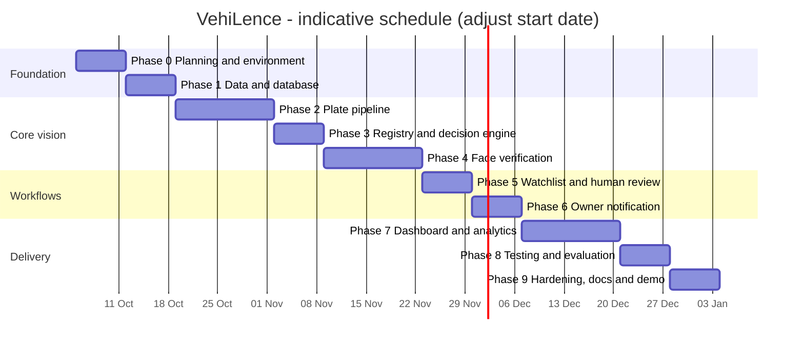

# Phase Definition & Delivery Plan — VehiLence

| Field | Value |
|---|---|
| Document | `phase_definition.md` |
| Version | 1.0 (Draft for review) |
| Date | 04 Oct 2026 |
| Author | [Vinisha Marina Dsouza] |
| Related documents | [problem_statement.md](problem_statement.md) · [prd.md](prd.md) · [tech_stack.md](tech_stack.md) · [architecture.md](architecture.md) |

---

## 1. How to Use This Plan

- The project is split into **10 phases (Phase 0–9)** plus an optional **Phase 10 (stretch)**.
- Each phase has a **goal, scope (PRD requirement IDs), tasks, deliverables, exit criteria and risks**.
- A phase is **done only when every exit criterion is met**. Do not start dependent phases early; build on stable foundations.
- Durations are **indicative** for one student working part-time to full-time (≈ 13 weeks). Adjust to your submission date using §15 (compression options).

## 2. Phase Overview

| Phase | Name | Duration | Main outcome | Depends on |
|---|---|---|---|---|
| 0 | Planning & Environment | 1 week | Repo, environment, phone stream and model imports all work | — |
| 1 | Data & Database Foundation | 1 week | Schema, seed script, dummy datasets with consent | 0 |
| 2 | Plate Recognition Pipeline | 2 weeks | Phone feed → validated plate text | 0, 1 |
| 3 | Registry Verification, Decision Engine v1 & Alerts v1 | 1 week | Plate-only decisions and simulated police alerts | 1, 2 |
| 4 | Face Verification | 2 weeks | Driver face vs owner: `MATCH` / `MISMATCH` / `UNVERIFIABLE` | 1, 3 |
| 5 | Watchlist Screening & Human Confirmation | 1 week | Wanted/missing screening with operator review queue | 4 |
| 6 | Owner Notification (Allow / Complain) | 1 week | Telegram workflow, timeouts, outcomes | 4, 5 |
| 7 | Dashboard, Geo-routing & Analytics | 2 weeks | Full operator/admin console, nearest-station routing | 3, 5, 6 |
| 8 | Integration Testing & Evaluation | 1 week | Scenario results and metrics for the report | 2–7 |
| 9 | Hardening, Documentation & Demo | 1 week | Polished system, report, demo and backup | 8 |
| 10 | Stretch / Post-MVP (optional) | as time allows | Liveness, clone check, extra validations | 8 |

The start date is illustrative; shift it to match your own calendar. The dashboard skeleton (Phase 7) can begin in parallel with Phases 5–6 if a second person helps.

## 3. Definition of Done (Applies to Every Phase)

A task is complete when:

1. Code is committed to a feature branch and merged to `main` through a pull request (even if self-reviewed).
2. Linting passes (`ruff`, `black`) and new logic has unit tests.
3. Configuration values are in config files, not hard-coded.
4. Documentation is updated (README or `docs/`).
5. The related PRD requirement IDs are demonstrated and ticked in the traceability table (§16).
6. A short demo clip or screenshot is saved for the report.

## 4. Phase 0 — Planning & Environment (Week 1)

**Goal:** Remove technical unknowns before writing real features.

**Scope:** Foundations for all FRs; NFR-POR-01, NFR-MNT-03.

| # | Task |
|---|---|
| 0.1 | Create the Git repository, branching model (`main` + feature branches) and issue board using the PRD requirements |
| 0.2 | Set up the Python 3.10/3.11 virtual environment and install the stack from [tech_stack.md §5](tech_stack.md) |
| 0.3 | Run the import smoke test: OpenCV, Ultralytics, EasyOCR, DeepFace, FastAPI, Streamlit |
| 0.4 | Stream the phone camera into OpenCV (IP Webcam/DroidCam) and measure latency and fps; try USB tethering as backup |
| 0.5 | Run pre-trained YOLOv8n on a few sample frames to confirm the GPU/CPU path works |
| 0.6 | Prepare a consent form template and a dataset log (`docs/datasets.md`) |
| 0.7 | Review and freeze the PRD with your guide; resolve open decisions D-01 to D-04 |
| 0.8 | Create project skeleton per [architecture.md §14](architecture.md), `.env.example`, `.gitignore`, pre-commit hooks |

**Deliverables:** repository with skeleton, working environment, phone-stream demo, signed-off PRD baseline.

**Exit criteria**
- [ ] One command builds the environment; the smoke test prints `OK`.
- [ ] Phone stream read at ≥ 10 fps with < 1 s visible delay (or documented alternative).
- [ ] PRD baseline agreed; open decisions recorded.

**Risks:** dependency conflicts (R4) and streaming instability (R5). Mitigation: decide on the InsightFace fallback now if DeepFace fails.

## 5. Phase 1 — Data & Database Foundation (Week 2)

**Goal:** A reproducible database with realistic dummy data covering all scenarios.

**Scope:** FR-ADM-01, FR-ADM-02, FR-ADM-04 (skeleton), FR-GEO-01/02 (data), FR-LOG-02 (table), FR-AUTH-02 (users table).

| # | Task |
|---|---|
| 1.1 | Implement SQLAlchemy models and Alembic migrations for all tables in [architecture.md §7.1](architecture.md) |
| 1.2 | Write repositories (CRUD) for vehicles, owners, faces, watchlists, stations, checkpoints |
| 1.3 | Collect consented volunteer photos: 8–12 owners (3–5 images each), 4–6 other drivers, 3–5 for `wanted_list`, 3–5 for `missing_reports` (or use synthetic faces); record consent |
| 1.4 | Create 20–30 vehicle records covering: permanent valid, temporary valid, temporary expired, stolen, missing, blacklisted |
| 1.5 | Create 3 stations and 2 checkpoints with coordinates |
| 1.6 | Write `scripts/seed_data.py` to rebuild everything with one command |
| 1.7 | Implement the audit-log append function (no update/delete path) and password-hashed user accounts (Admin, Police Op, Checkpoint Op, Viewer) |

**Deliverables:** migrations, seed script, dataset log, consent records, ER diagram exported.

**Exit criteria**
- [ ] `python scripts/seed_data.py` creates the full dataset from an empty database.
- [ ] All scenario categories (S01–S18) have matching seed records.
- [ ] Consent recorded for every real face; no real wanted/missing persons used.

**Risks:** volunteers unavailable → fall back to public or synthetic faces and document it.

## 6. Phase 2 — Plate Recognition Pipeline (Weeks 3–4)

**Goal:** Reliable, validated plate text from the live phone feed.

**Scope:** FR-CAP-01…06, FR-PLT-01…09; NFR-PERF-01, NFR-PERF-04, NFR-ACC-01/02.

| # | Task |
|---|---|
| 2.1 | Build the frame grabber (thread, bounded queue, auto-reconnect) |
| 2.2 | Integrate pre-trained vehicle detection (YOLOv8n) |
| 2.3 | Assemble and label the plate dataset (public data + own images) via Roboflow/Label Studio; split train/val/**held-out test (≥ 100 images)** |
| 2.4 | Fine-tune the plate detector (Colab/Kaggle); record mAP, precision, recall |
| 2.5 | Implement preprocessing (grayscale, denoise, CLAHE, deskew) and compare OCR accuracy with/without it |
| 2.6 | Integrate EasyOCR (allow-list) with Tesseract fallback |
| 2.7 | Implement normalisation, position-aware correction and regex validation (`plate_patterns.yaml`) |
| 2.8 | Implement multi-frame voting, confidence gate and `NO_PLATE` timeout |
| 2.9 | Save evidence crops; add overlays to a preview window |
| 2.10 | Build an offline evaluation script for plate detection recall and OCR exact-match |

**Deliverables:** `pipeline/` modules, trained detector weights, plate evaluation results.

**Exit criteria**
- [ ] Detection recall ≥ 90% and OCR exact-match ≥ 85% on the held-out set (or gaps documented with a plan).
- [ ] Single-frame misreads never reach the registry (voting verified by test).
- [ ] ≥ 5 fps sustained on the dev laptop.
- [ ] Unreadable plate → `NO_PLATE`, never a guess.

**Risks:** R1 (OCR on Indian plates). Mitigation: more own images, stronger augmentation, `yolov8s`, tune preprocessing.

## 7. Phase 3 — Registry Verification, Decision Engine v1 & Alerts v1 (Week 5)

**Goal:** End-to-end *plate-only* flow, from camera to a simulated police alert.

**Scope:** FR-REG-01…06, FR-ALR-01…06, FR-GEO-02, FR-LOG-01, FR-HC-05 (data model for review); NFR-ACC-05/06, NFR-MNT-02, NFR-REL-01.

| # | Task |
|---|---|
| 3.1 | Implement registry lookup and status classification (permanent, temporary valid/expired, unregistered, stolen, missing, blacklisted) |
| 3.2 | Implement the **decision engine as a pure function** with reason codes, driven by the PRD §5 matrix (rows 1–4 now; others stubbed) |
| 3.3 | Write table-driven unit tests for every matrix row (target 100% branch coverage of the engine) |
| 3.4 | Implement nearest-station routing (Haversine) |
| 3.5 | Build the alert service: payload, types, severity, de-duplication/cooldown |
| 3.6 | Build the outbox, scheduler, retry/back-off and the **simulated** notifier; add SMTP notifier |
| 3.7 | Persist sessions with scores, timings and reason codes |
| 3.8 | Create the minimal review-case table and a CLI/endpoint to list cases (UI comes in Phase 7) |

**Deliverables:** decision engine, alert service, outbox, tests, first recorded demo (plate → alert).

**Exit criteria**
- [ ] Scenarios S04–S08, S12, S15, S16 pass automatically.
- [ ] Alert contains plate, location, timestamp, evidence and correct nearest station.
- [ ] Simulated network failure → alert delivered after retry (M7).
- [ ] 100% branch coverage on the decision engine implemented so far.

**Risks:** logic scattered across modules. Mitigation: keep all rules in `decision_engine.py`; no business logic in notifiers or UI.

## 8. Phase 4 — Face Verification (Weeks 6–7)

**Goal:** Trustworthy driver-vs-owner verification with an honest `UNVERIFIABLE` state.

**Scope:** FR-CAP-03, FR-FACE-01…06; NFR-PERF-02, NFR-ACC-03, NFR-ETH-01.

| # | Task |
|---|---|
| 4.1 | Wrap DeepFace behind a `FaceService` interface (detect, quality, embed, compare) so models are swappable |
| 4.2 | Implement the quality gate (face size, sharpness, brightness, pose) and recapture retries |
| 4.3 | Enrol owner faces (1–5 images), compute and store embeddings |
| 4.4 | Implement Stage B capture: auto-trigger when a usable face appears, plus manual trigger |
| 4.5 | Implement 1:1 comparison (min distance across references) with cosine distance |
| 4.6 | Collect a verification test set: genuine pairs and impostor pairs, varied light/angle/glasses; compute FAR/FRR and ROC; **select thresholds** from data |
| 4.7 | Integrate face results into the decision engine (rows 5, 6 and the mismatch branch) |
| 4.8 | Add tests: `UNVERIFIABLE` never becomes `MATCH` or `MISMATCH` |

**Deliverables:** `FaceService`, threshold report (ROC, chosen operating point), integrated plate+face flow.

**Exit criteria**
- [ ] TAR ≥ 90% at FAR ≤ 1% on the volunteer test set (or honest gap analysis).
- [ ] Poor-quality faces are rejected with a reason, not guessed.
- [ ] Scenarios S01, S13 pass; mismatch path reaches the (stubbed) owner/watchlist branch.
- [ ] Face decision ≤ 2 s.

**Risks:** R2 (face reliability). Mitigation: more reference images, quality gate, tune threshold on own data, document failure conditions.

## 9. Phase 5 — Watchlist Screening & Human Confirmation (Week 8)

**Goal:** Safe, human-supervised matching against `wanted_list` and `missing_reports`.

**Scope:** FR-WL-01…05, FR-HC-01…05; NFR-PRV-05, NFR-ACC-04.

| # | Task |
|---|---|
| 5.1 | Implement 1:N matrix cosine search over both watchlists with the stricter threshold and top-K |
| 5.2 | On mismatch: run screening **before** any owner notification; create `PENDING` review case; hold notification |
| 5.3 | Implement review-case state machine (`PENDING → CONFIRMED / REJECTED / ESCALATED`); forbid any path from `PENDING` to dispatch without a human action |
| 5.4 | Implement operator decision endpoint (with note) and audit logging |
| 5.5 | **Confirm** → `WANTED_PERSON_MATCH` or `MISSING_PERSON_MATCH` alert; **Reject** → continue to owner flow |
| 5.6 | Add the `WATCHLIST_SCOPE` switch (`mismatch_only` / `all_faces`) |
| 5.7 | Measure watchlist false-match behaviour on non-listed volunteers; document |
| 5.8 | Extend the review queue to other reasons (`NO_PLATE`, `FACE_UNVERIFIABLE`, low OCR, fuzzy plate, owner timeout) |

**Deliverables:** watchlist screening module, review workflow (API-level), tests, false-match analysis.

**Exit criteria**
- [ ] Scenarios S09, S10, S11 pass.
- [ ] Test proves no alert from a watchlist match without a recorded operator decision (M6 = 0).
- [ ] Owner is not notified while a review is pending.

**Risks:** R3 (false matches). Mitigation: strict threshold; operator sees side-by-side images and score.

## 10. Phase 6 — Owner Notification: Allow / Complain (Week 9)

**Goal:** Let owners resolve mismatches with one tap.

**Scope:** FR-OWN-01…07; NFR-SEC-04, NFR-USA-03.

| # | Task |
|---|---|
| 6.1 | Create the Telegram bot; link owner chat IDs through a simple `/start <code>` binding stored in the owner record |
| 6.2 | Send notification: plate, time, location, driver snapshot, inline **Allow** / **Complain** buttons |
| 6.3 | Handle callbacks: verify chat ID, enforce single-use, idempotency and expiry; log every response |
| 6.4 | **Allow** → `AUTHORIZED_DRIVER`; **Complain** → HIGH `UNAUTHORIZED_USE` alert to the nearest station |
| 6.5 | Implement the response timeout job → move to operator review (D-01 default); demo timeout configurable (e.g. 2 min) |
| 6.6 | Build the signed-link web fallback endpoint (optional) |
| 6.7 | Persist pending confirmations so a restart does not lose them |

**Deliverables:** Telegram notifier and callbacks, timeout scheduler, tests.

**Exit criteria**
- [ ] Scenarios S02, S03, S14 pass.
- [ ] Forged or replayed responses are rejected; only the first response counts.
- [ ] Pending confirmations survive a backend restart.

**Risks:** Telegram connectivity at the demo venue. Mitigation: keep a simulated owner-response panel in the dashboard as backup.

## 11. Phase 7 — Dashboard, Geo-routing & Analytics (Weeks 10–11)

**Goal:** A professional operator and admin console on top of the API.

**Scope:** FR-DSH-01…08, FR-ADM-01/03, FR-GEO-01/02 (UI), FR-AUTH-01…03, FR-LOG-02 (UI); NFR-PERF-05, NFR-USA-01/02, NFR-OBS-*.

| # | Task |
|---|---|
| 7.1 | Login, JWT handling and role-based page access |
| 7.2 | Live feed page with outcome badges and system-health panel |
| 7.3 | Alerts page with filters and acknowledgement actions |
| 7.4 | **Review queue** page: side-by-side images, score, Confirm/Reject, note field |
| 7.5 | Search and detail page: all scores, thresholds, reason codes, timings, evidence |
| 7.6 | Admin pages: vehicles, owners with face enrolment, watchlists, stations, checkpoints, thresholds |
| 7.7 | Analytics: outcomes per day, hourly pattern, top flagged plates, alert map, FAR/FRR display from the evaluation run |
| 7.8 | Audit-log viewer; CSV export |
| 7.9 | Usability pass with 2–3 test users; fix confusing screens |

**Deliverables:** complete Streamlit dashboard, admin tooling, usability notes.

**Exit criteria**
- [ ] Every PRD "Must" dashboard/admin requirement works for the right role and is blocked for others.
- [ ] Review queue works end-to-end (Confirm → alert; Reject → owner flow).
- [ ] A new user completes a checkpoint session after ≤ 5 minutes of instruction.

## 12. Phase 8 — Integration Testing & Evaluation (Week 12)

**Goal:** Prove the system works and quantify how well.

**Scope:** All FRs; NFR-ACC-*, NFR-PERF-*, NFR-REL-*, NFR-SEC-*, NFR-ETH-01/02.

| # | Task |
|---|---|
| 8.1 | Execute all scenarios **S01–S18** (live and replay); record outcome, evidence and timing |
| 8.2 | Run the evaluation script: plate detection recall, OCR exact-match, FAR/FRR/ROC, watchlist false matches, end-to-end latency |
| 8.3 | Test failure modes: stream drop, SMTP/Telegram down, backend restart, duplicate responses |
| 8.4 | Run security checks: role bypass attempts, token replay, `pip-audit`, secrets scan |
| 8.5 | Test under varied conditions (light, angle, glasses, hat, distance) and document where accuracy drops |
| 8.6 | Compile the results tables and charts for the report |
| 8.7 | Fix defects; re-run the failed scenarios |

**Deliverables:** test report, evaluation tables/charts, defect log, limitations list.

**Exit criteria**
- [ ] All Must-level scenarios pass; any failures are documented with cause and impact.
- [ ] Metrics M1–M7 reported (met or honestly explained).
- [ ] No open critical or high defects.

## 13. Phase 9 — Hardening, Documentation & Demo (Week 13)

**Goal:** A stable, well-documented, rehearsed submission.

**Scope:** NFR-MNT-*, NFR-POR-*, NFR-SEC-01/07/08, NFR-PRV-*.

| # | Task |
|---|---|
| 9.1 | Freeze features; only bug fixes from now on |
| 9.2 | Pin dependency versions; tag release `v1.0`; (optional) Docker setup |
| 9.3 | Update README: install, configure, seed, run, demo steps |
| 9.4 | Finalise the project report: add limitations, privacy/ethics section, evaluation results, architecture figures |
| 9.5 | Prepare the demo script (scenarios in a fixed order, ≈ 10 minutes) and a **backup video** of every scenario |
| 9.6 | Prepare **offline fallback**: recorded-session replay, simulated alert mode, simulated owner panel |
| 9.7 | Rehearse at least twice, including a Q&A on accuracy, privacy and legality |
| 9.8 | Pre-demo checklist: charged phone, tripod, network, tokens, seed data, models loaded, backup laptop/USB |

**Deliverables:** tagged release, final report, slides, demo script, backup video.

**Exit criteria**
- [ ] Fresh-machine install works from the README.
- [ ] Two full rehearsals completed without blocking issues.
- [ ] Report, slides and artefacts submitted.

## 14. Phase 10 — Stretch Goals (Optional, After Phase 8)

Pick in this order only if time remains:

| # | Feature | PRD ref | Value |
|---|---|---|---|
| 10.1 | Basic liveness (blink / head-turn) | FR-FACE-07 | Resists photo spoofing |
| 10.2 | Clone check using make / model / colour | FR-REG-06 | Detects plates copied onto a different vehicle |
| 10.3 | `all_faces` watchlist scope as default after discussion | FR-WL-05 | Catches wanted owners driving their own vehicle |
| 10.4 | Insurance / PUC / challan flags (dummy data) | — | Extra low-severity checks |
| 10.5 | Phone GPS for location | FR-GEO-03 | More realistic geo-tagging |
| 10.6 | Report PDF export from the dashboard | FR-DSH-08 | Audit convenience |
| 10.7 | Docker compose packaging | NFR-POR-03 | Easy setup |

## 15. MVP Cut Line and Compression Options

**MVP (must be complete for a credible demo):** Phases 0–6 plus a minimal version of Phase 7 (live feed, alerts, review queue) and Phase 8 scenarios S01–S14.

If the deadline is shorter than 13 weeks, compress in this order:

1. Reduce Phase 7 to the pages needed for the demo; leave analytics and export for later.
2. Use the simulated notifier for police and skip SMTP/Twilio.
3. Use synthetic or public faces if volunteers are hard to find.
4. Merge Phase 3 into Phase 2's last week (the decision engine is quick if the matrix is already agreed).
5. Never cut: decision-engine tests, the `UNVERIFIABLE` state, the human-confirmation rule, consent/data rules, and the evaluation.

## 16. Requirement-to-Phase Traceability

| Requirement group | Phase(s) |
|---|---|
| FR-CAP (Capture) | 2, 4 |
| FR-PLT (Plate recognition) | 2 |
| FR-REG (Registry verification) | 3 |
| FR-FACE (Face verification) | 4 (liveness: 10) |
| FR-WL (Watchlist screening) | 5 |
| FR-HC (Human confirmation) | 3 (model), 5 (logic), 7 (UI) |
| FR-OWN (Owner confirmation) | 6 |
| FR-ALR (Alerts) | 3, 6 |
| FR-GEO (Geo-routing) | 1 (data), 3 (logic), 7 (UI) |
| FR-DSH (Dashboard) | 7 |
| FR-ADM (Administration) | 1, 7 |
| FR-LOG (Logging, audit, evaluation) | 1, 3, 7, 8 |
| FR-AUTH (Authentication) | 1, 7 |
| NFR-PERF / ACC | 2, 4, 8 |
| NFR-SEC / PRV | 1, 6, 8, 9 |
| NFR-MNT / POR | 0, 3, 9 |

## 17. Phase Gate Checklist (Quick Reference)

| Gate | Question | Evidence |
|---|---|---|
| G0 | Does the environment, phone stream and model stack work? | Smoke test, demo clip |
| G1 | Can the database be rebuilt from scratch with scenario coverage? | Seed run |
| G2 | Is plate recognition accurate and safe (no guessing)? | Plate evaluation |
| G3 | Do plate-only decisions and alerts work reliably? | S04–S08, S12, S15, S16 |
| G4 | Is face verification measured and thresholds chosen from data? | ROC and FAR/FRR report |
| G5 | Is every watchlist action human-confirmed? | Test for M6 = 0 |
| G6 | Does the owner Allow/Complain flow work and resist replay? | S02, S03, S14 |
| G7 | Can operators and admins do their jobs in the UI? | Usability notes |
| G8 | Are results measured and honestly reported? | Evaluation tables |
| G9 | Is it stable, documented and rehearsed? | Release tag, backup video |

## 18. Revision History

| Version | Date | Change |
|---|---|---|
| 1.0 | 04 Oct 2026 | Initial phase plan |
