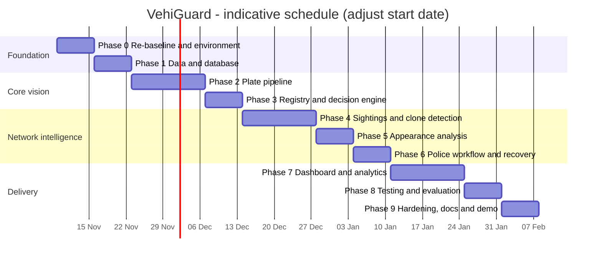

# Phase Definition & Delivery Plan — VehiGuard

| Field | Value |
|---|---|
| Document | `phase_definition.md` |
| Version | 2.0 (Draft for review) |
| Date | 09 Nov 2026 |
| Author | [Vinisha Marina Dsouza] |
| Related documents | [problem_statement.md](problem_statement.md) · [prd.md](prd.md) · [tech_stack.md](tech_stack.md) · [architecture.md](architecture.md) |

---

## 1. How to Use This Plan

- The project is split into **10 phases (Phase 0–9)** plus an optional **Phase 10 (stretch)**.
- Each phase has a **goal, scope (PRD requirement IDs), tasks, deliverables, exit criteria and risks**.
- A phase is **done only when every exit criterion is met**. Do not start dependent phases early; build on stable foundations.
- Durations are **indicative** for one student working part-time to full-time (≈ 13 weeks). Adjust to your submission date using §15 (compression options).
- The project changed direction on 09 Nov 2026 (from VehiLence to VehiGuard). Work from the earlier plan that still applies is listed under **Carry-over** in Phase 0.

## 2. Phase Overview

| Phase | Name | Duration | Main outcome | Depends on |
|---|---|---|---|---|
| 0 | Re-baseline & Environment | 1 week | Repo, environment (PaddleOCR, PostgreSQL, React), phone stream and model imports all work | — |
| 1 | Data & Database Foundation | 1 week | Schema, seed script, own dummy database, consented data | 0 |
| 2 | Plate Recognition Pipeline | 2 weeks | Phone feed → validated plate text | 0, 1 |
| 3 | Registry, Stolen/Missing Matching, Decision Engine v1 & Alerts v1 | 1 week | Plate-only decisions and simulated police alerts | 1, 2 |
| 4 | Sightings, Multi-camera & Clone Detection | 2 weeks | Cross-camera impossible-journey detection | 3 |
| 5 | Vehicle Appearance Analysis | 1 week | Type and colour comparison with the registry and earlier sightings | 4 |
| 6 | Police Workflow: Alert Status, Evidence & Recovery Tracking | 1 week | Alert workflow, evidence retention, recovery status | 3, 5 |
| 7 | Dashboard (React), Geo-routing & Analytics | 2 weeks | Full officer/admin console with maps | 3, 4, 5, 6 |
| 8 | Integration Testing & Evaluation | 1 week | Scenario results and metrics for the report | 2–7 |
| 9 | Hardening, Documentation & Demo | 1 week | Polished system, report, demo and backup | 8 |
| 10 | Stretch / Post-MVP (optional) | as time allows | Embedding similarity, PostGIS, extra checks | 8 |

The start date is illustrative; shift it to match your own calendar. The dashboard skeleton (Phase 7) can begin in parallel with Phases 5–6 if a second person helps.

## 3. Definition of Done (Applies to Every Phase)

A task is complete when:

1. Code is committed to a feature branch and merged to `main` through a pull request (even if self-reviewed).
2. Linting passes (`ruff`, `black`) and new logic has unit tests.
3. Configuration values are in config files, not hard-coded.
4. Documentation is updated (README or `docs/`).
5. The related PRD requirement IDs are demonstrated and ticked in the traceability table (§16).
6. A short demo clip or screenshot is saved for the report.

## 4. Phase 0 — Re-baseline & Environment (Week 1)

**Goal:** Move the existing setup to the VehiGuard stack and remove technical unknowns before writing real features.

**Scope:** Foundations for all FRs; NFR-POR-01, NFR-MNT-03.

**Carry-over from the earlier plan:** Git repository and branching, Python virtual environment, OpenCV, YOLOv8n test, pre-commit hooks (black + ruff), consent and dataset-log approach, Nepal plate-detector baseline.

| # | Task |
|---|---|
| 0.1 | Update the repository: rename or re-describe it as VehiGuard, replace the old README, and move the earlier documents into `docs/archive/` if you want to keep them |
| 0.2 | Install the new Python packages from [tech_stack.md §5](tech_stack.md) (PaddlePaddle, PaddleOCR, SQLAlchemy, Alembic, psycopg, FastAPI and the rest). Face-recognition packages are no longer needed |
| 0.3 | Run the import smoke test: OpenCV, Ultralytics, PaddleOCR, EasyOCR, FastAPI, SQLAlchemy, psycopg |
| 0.4 | Install PostgreSQL, create the `vehiguard` database, and connect from Python |
| 0.5 | Install Node.js (LTS) and create the React (Vite) dashboard skeleton; confirm it runs and can call a test API endpoint |
| 0.6 | Get a phone camera stream into OpenCV with an app that works on your network (DroidCam, Iriun Webcam or IP Webcam). Measure latency and fps. Test whether a **second phone** can connect; if not, plan on re-registering one phone or using recorded video |
| 0.7 | Test PaddleOCR and EasyOCR on a few plate photos to confirm both run |
| 0.8 | Update the consent form and dataset log ([consent_form.md](consent_form.md), [datasets.md](datasets.md)) |
| 0.9 | Review and freeze the PRD with your guide; resolve open decisions D-01 to D-03 |
| 0.10 | Update the project skeleton per [architecture.md §14](architecture.md), `.env.example`, `.gitignore` (add `data/`, `*.dump`, `*.sql` backups) |

**Deliverables:** updated repository skeleton, working environment, phone-stream demo, signed-off PRD baseline.

**Exit criteria**
- [ ] One command builds the environment; the smoke test prints `OK`.
- [ ] PostgreSQL connection works; the React skeleton runs.
- [ ] Phone stream read at ≥ 10 fps with < 1 s visible delay (or a documented alternative).
- [ ] PRD baseline agreed; open decisions recorded.

**Risks:** dependency conflicts (R4), streaming instability (R5), learning load of the new stack (R11). Mitigation: EasyOCR stays as the OCR fallback; keep the first dashboard page minimal.

## 5. Phase 1 — Data & Database Foundation (Week 2)

**Goal:** A reproducible database with realistic dummy data covering all scenarios.

**Scope:** FR-ADM-01, FR-ADM-02, FR-GEO-01 (data), FR-REG-02, FR-LOG-02 (table), FR-AUTH-02 (users table).

| # | Task |
|---|---|
| 1.1 | Implement SQLAlchemy models and Alembic migrations for all tables in [architecture.md §7.1](architecture.md), with indexes on `sightings(plate_no, observed_at)` |
| 1.2 | Write repositories (CRUD) for vehicles, reports, stations, cameras and users |
| 1.3 | Collect consented volunteer vehicle photos or videos: 6–10 vehicles with real plates, plus your own captures; record consent per [consent_form.md](consent_form.md) |
| 1.4 | Create 20–30 vehicle records (type, make, model, colour family, fictional owner) that include the test vehicles |
| 1.5 | Create 4–6 stolen/missing reports in different recovery statuses (fictional FIR references) |
| 1.6 | Create 3 police stations and 3 cameras with assigned coordinates. Place two cameras far enough apart (for example about 38 km) to make impossible journeys testable |
| 1.7 | Write `scripts/seed_data.py` to rebuild everything with one command |
| 1.8 | Implement the audit-log append function (no update/delete path) and password-hashed user accounts (Admin, Police Officer, Camera Operator, Viewer) |

**Deliverables:** migrations, seed script, dataset log, consent records, ER diagram exported.

**Exit criteria**
- [ ] `python scripts/seed_data.py` creates the full dataset from an empty database.
- [ ] All scenario categories (S01–S17) have matching seed records.
- [ ] Consent recorded for every real vehicle and plate used; no real stolen-vehicle data used.

**Risks:** volunteers unavailable → use your own captures, parked vehicles with the owner's permission, or public datasets, and document it.

## 6. Phase 2 — Plate Recognition Pipeline (Weeks 3–4)

**Goal:** Reliable, validated plate text from the live phone feed.

**Scope:** FR-CAP-01…07, FR-PLT-01…09; NFR-PERF-01, NFR-PERF-03, NFR-ACC-01/02.

| # | Task |
|---|---|
| 2.1 | Build the frame grabber per camera (thread, bounded queue, auto-reconnect, server timestamps) and the camera registry |
| 2.2 | Integrate pre-trained vehicle detection (YOLOv8n) |
| 2.3 | Assemble and label the plate dataset (public data + own images) via Roboflow/Label Studio; split train/val/**held-out test (≥ 100 images)** |
| 2.4 | Fine-tune the plate detector (Colab/Kaggle); record mAP, precision, recall; compare with the Nepal baseline (D07) |
| 2.5 | Implement preprocessing (grayscale, denoise, CLAHE, deskew) and compare OCR accuracy with and without it |
| 2.6 | Integrate PaddleOCR with the EasyOCR fallback; compare both on the test set |
| 2.7 | Implement normalisation, position-aware correction and regex validation (`plate_patterns.yaml`) |
| 2.8 | Implement multi-frame voting, the confidence gate and the `NO_PLATE` timeout |
| 2.9 | Save evidence crops; add overlays to a preview window; support replay mode (video file / image folder) |
| 2.10 | Build an offline evaluation script for plate detection recall and OCR exact-match |

**Deliverables:** `pipeline/` modules, trained detector weights, plate evaluation results.

**Exit criteria**
- [ ] Detection recall ≥ 90% and OCR exact-match ≥ 85% on the held-out set (or gaps documented with a plan).
- [ ] Single-frame misreads never reach the registry (voting verified by test).
- [ ] ≥ 5 fps sustained from one camera on the dev laptop.
- [ ] Unreadable plate → `NO_PLATE`, never a guess.
- [ ] A dropped stream reconnects within 10 s and the other camera is unaffected (S15).

**Risks:** R1 (OCR on Indian plates). Mitigation: more own images, stronger augmentation, `yolov8s`, tune preprocessing, fall back to EasyOCR if it performs better.

## 7. Phase 3 — Registry, Stolen/Missing Matching, Decision Engine v1 & Alerts v1 (Week 5)

**Goal:** End-to-end *plate-only* flow, from camera to a simulated police alert.

**Scope:** FR-REG-01…05, FR-ALR-01…06, FR-GEO-02, FR-LOG-01, FR-PLT-08; NFR-ACC-05/06, NFR-MNT-02, NFR-REL-01.

| # | Task |
|---|---|
| 3.1 | Implement registry lookup and the matching of plates against active stolen/missing reports |
| 3.2 | Implement the **decision engine as a pure function** with reason codes, driven by the PRD §5 matrix (rows 1, 2, 3, 7, 8 now; rows 4–6 stubbed) |
| 3.3 | Write table-driven unit tests for every implemented matrix row (target 100% branch coverage of the engine) |
| 3.4 | Implement nearest-station routing (Haversine) |
| 3.5 | Build the alert service: payload, types, severity, de-duplication/cooldown |
| 3.6 | Build the outbox, scheduler, retry/back-off and the **simulated** notifier; add the SMTP notifier |
| 3.7 | Persist sightings with scores, timings and reason codes |
| 3.8 | Implement the fuzzy `POSSIBLE_MATCH` item (review only, never an alert) |

**Deliverables:** decision engine, alert service, outbox, tests, first recorded demo (plate → alert).

**Exit criteria**
- [ ] Scenarios S01, S03, S04, S08, S09, S10, S12, S13 pass automatically.
- [ ] Alert contains plate, location, timestamp, evidence and the correct nearest station.
- [ ] Simulated network failure → alert delivered after retry (M7).
- [ ] 100% branch coverage on the decision engine implemented so far.

**Risks:** logic scattered across modules. Mitigation: keep all rules in `decision_engine.py`; no business logic in notifiers or UI.

## 8. Phase 4 — Sightings, Multi-camera & Clone Detection (Weeks 6–7)

**Goal:** Detect suspected cloned plates from physically impossible journeys.

**Scope:** FR-CAP-03, FR-SIG-01…03, FR-CLN-01…03, 05, 07; FR-GEO-02; NFR-PERF-05.

| # | Task |
|---|---|
| 4.1 | Implement sighting creation and per-camera de-duplication (`SIGHTING_COOLDOWN_S`) |
| 4.2 | Run two or more cameras at the same time, each with its own worker and camera ID |
| 4.3 | Implement the clone analyser: find earlier sightings at other cameras within `CLONE_WINDOW_H` |
| 4.4 | Implement the impossible-journey rule exactly as in [architecture.md §8.3](architecture.md), with tolerance and minimum distance |
| 4.5 | Table-driven tests for the rule, including borderline cases: exactly at the limit, zero time gap, same camera, cameras too close, outside the window |
| 4.6 | Store the journey (cameras, distance, time gap, required speed) with the alert; attach both sightings' evidence |
| 4.7 | Record scripted scenario clips: genuine repeat sightings (S02, S17) and clone cases (S05, S06) |
| 4.8 | Measure false clone alerts on the genuine multi-camera clips (M5) |

**Deliverables:** clone analyser with tests, scenario recordings, first `SUSPECTED_CLONE` alerts (severity set after Phase 5).

**Exit criteria**
- [ ] Scenarios S02, S06 (as IJ-only), S17 pass; S05 raises a suspected clone alert (final severity after Phase 5).
- [ ] No false clone alert on any genuine multi-camera clip.
- [ ] Clone analysis ≤ 500 ms per sighting.
- [ ] Same-camera sightings never create clone alerts.

**Risks:** R3 (false clone from a misread plate), R6 (simulated locations). Mitigation: confidence gate, voting, conservative rule, clear documentation of the assigned coordinates.

## 9. Phase 5 — Vehicle Appearance Analysis (Week 8)

**Goal:** Compare what the vehicle looks like with the registry and with earlier sightings, without false alarms from poor light.

**Scope:** FR-APP-01…05 (06 optional), FR-CLN-04; NFR-ACC-03.

| # | Task |
|---|---|
| 5.1 | Extract vehicle type from the detector class, with majority voting over frames |
| 5.2 | Implement colour extraction (body crop, HSV, dominant colour) and the colour-family mapping |
| 5.3 | Implement the `UNKNOWN` rule for dark, small or blurred crops |
| 5.4 | Implement RM (against the registry) and AM (against the earlier sighting) |
| 5.5 | Complete the decision engine: rows 4, 5 and 6 of the PRD §5 matrix; extend tests to 100% branch coverage |
| 5.6 | Build the appearance test set (≥ 100 labelled crops) and measure type and colour accuracy |
| 5.7 | Tune colour families on the test set; document conditions where colour fails |

**Deliverables:** appearance module, completed decision engine, appearance accuracy results.

**Exit criteria**
- [ ] Type accuracy ≥ 90% and colour-family accuracy ≥ 80% on the test set (or honest gap analysis).
- [ ] Scenarios S05 (HIGH), S06 (MEDIUM), S07 (LOW) and S11 pass.
- [ ] `UNKNOWN` never produces a mismatch (verified by test).

**Risks:** R2 (colour under changing light). Mitigation: colour families, voting, `UNKNOWN` state, LOW severity for appearance-only signals.

## 10. Phase 6 — Police Workflow: Alert Status, Evidence & Recovery Tracking (Week 9)

**Goal:** Let officers act on alerts and follow stolen vehicles through to recovery.

**Scope:** FR-ALR-07; FR-CASE-01…05; FR-EVD-01…04; FR-ADM-04; NFR-PRV-07.

| # | Task |
|---|---|
| 6.1 | Implement the alert status workflow with status history, user and note |
| 6.2 | Implement recovery status transitions per [architecture.md §6.3](architecture.md); reject disallowed transitions |
| 6.3 | Automatic `REPORTED → DETECTED` when a stolen/missing alert is created |
| 6.4 | Endpoint to create stolen/missing reports (Officer, Admin) |
| 6.5 | Evidence hashing (SHA-256) and the retention purge job that skips open cases |
| 6.6 | Role checks: Viewer and Camera Operator cannot change statuses |
| 6.7 | Audit-log entries for every status change |

**Deliverables:** case manager, retention job, tests.

**Exit criteria**
- [ ] Scenarios S14, S16 pass.
- [ ] Evidence older than the retention period is purged, except for open cases (verified with back-dated data).
- [ ] Every status change appears in the status history and audit log.

**Risks:** status rules getting complicated. Mitigation: keep the transition table in one place and test every pair.

## 11. Phase 7 — Dashboard (React), Geo-routing & Analytics (Weeks 10–11)

**Goal:** A professional officer and admin console on top of the API.

**Scope:** FR-DSH-01…09, FR-ADM-01/03, FR-GEO-01…03 (UI), FR-AUTH-01…03, FR-LOG-02 (UI), FR-CAP-05, 07; NFR-PERF-04, NFR-USA-01…03, NFR-OBS-*.

| # | Task |
|---|---|
| 7.1 | Login, JWT handling and role-based page and button access |
| 7.2 | Live monitor page: recent sightings with badges, camera status, system-health panel; live updates via Server-Sent Events or polling |
| 7.3 | Alerts page with filters and status controls |
| 7.4 | **Alert detail** page: reason in plain language, both evidence sets side by side, journey map (Leaflet) with the line between cameras, scores |
| 7.5 | Plate search and per-plate sighting timeline |
| 7.6 | Stolen/missing reports page with recovery status controls and history |
| 7.7 | Admin pages: vehicles, stations, cameras, users, thresholds |
| 7.8 | Analytics: sightings and alerts per day, hourly pattern, top flagged plates, alert map, recovery pipeline |
| 7.9 | `POSSIBLE_MATCH` review list; audit-log viewer; CSV export |
| 7.10 | Usability pass with 2–3 test users; fix confusing screens |

**Deliverables:** complete React dashboard, admin tooling, usability notes.

**Exit criteria**
- [ ] Every PRD "Must" dashboard/admin requirement works for the right role and is blocked for others.
- [ ] A suspected-clone alert can be opened, understood from the screen alone, and closed with a note.
- [ ] A new user registers a camera and runs a session after ≤ 5 minutes of instruction.

## 12. Phase 8 — Integration Testing & Evaluation (Week 12)

**Goal:** Prove the system works and quantify how well.

**Scope:** All FRs; NFR-ACC-*, NFR-PERF-*, NFR-REL-*, NFR-SEC-*, NFR-ETH-01/02.

| # | Task |
|---|---|
| 8.1 | Execute all scenarios **S01–S17** (live and replay); record outcome, evidence and timing |
| 8.2 | Run the evaluation script: plate detection recall, OCR exact-match, type and colour accuracy, clone-detection correctness (M4), false clone alerts (M5), end-to-end latency (M8) |
| 8.3 | Test failure modes: stream drop, SMTP down, backend restart, duplicate detections |
| 8.4 | Run security checks: role bypass attempts, `pip-audit`, `npm audit`, secrets scan |
| 8.5 | Test under varied conditions (light, angle, distance, dirty or tilted plates) and document where accuracy drops |
| 8.6 | Compile the results tables and charts for the report |
| 8.7 | Fix defects; re-run the failed scenarios |

**Deliverables:** test report, evaluation tables/charts, defect log, limitations list.

**Exit criteria**
- [ ] All Must-level scenarios pass; any failures are documented with cause and impact.
- [ ] Metrics M1–M8 reported (met or honestly explained).
- [ ] No open critical or high defects.

## 13. Phase 9 — Hardening, Documentation & Demo (Week 13)

**Goal:** A stable, well-documented, rehearsed submission.

**Scope:** NFR-MNT-*, NFR-POR-*, NFR-SEC-01/06/07, NFR-PRV-*.

| # | Task |
|---|---|
| 9.1 | Freeze features; only bug fixes from now on |
| 9.2 | Pin dependency versions; tag release `v1.0`; (optional) Docker setup |
| 9.3 | Update README: install, configure, seed, run, demo steps |
| 9.4 | Finalise the project report: limitations, privacy/ethics section, evaluation results, architecture figures; state clearly that camera coordinates are assigned |
| 9.5 | Prepare the demo script (scenarios in a fixed order, ≈ 10 minutes) and a **backup video** of every scenario |
| 9.6 | Prepare the **offline fallback**: recorded-session replay, simulated alert mode, offline map fallback |
| 9.7 | Rehearse at least twice, including a Q&A on accuracy, privacy and legality |
| 9.8 | Pre-demo checklist: charged phones, tripods, network, `.env`, seed data, models loaded, PostgreSQL running, backup laptop/USB |

**Deliverables:** tagged release, final report, slides, demo script, backup video.

**Exit criteria**
- [ ] Fresh-machine install works from the README.
- [ ] Two full rehearsals completed without blocking issues.
- [ ] Report, slides and artefacts submitted.

## 14. Phase 10 — Stretch Goals (Optional, After Phase 8)

Pick in this order only if time remains:

| # | Feature | PRD ref | Value |
|---|---|---|---|
| 10.1 | Vehicle image-embedding similarity as an extra appearance signal | FR-APP-06 | Stronger clone evidence than colour and type alone |
| 10.2 | PostGIS for distance and nearest-station queries | NFR-SCL-02 | Standard geospatial tooling |
| 10.3 | Phone GPS for camera location | FR-GEO-04 | More realistic geo-tagging |
| 10.4 | Report PDF export from the dashboard | FR-DSH-08 | Convenience |
| 10.5 | Docker compose packaging | NFR-POR-03 | Easy setup |
| 10.6 | Simple route view for a flagged vehicle across its sightings | FR-DSH-05 | Better investigator view |

## 15. MVP Cut Line and Compression Options

**MVP (must be complete for a credible demo):** Phases 0–6 plus a minimal version of Phase 7 (live monitor, alerts, alert detail with journey map, reports page) and Phase 8 scenarios S01–S12 and S14.

If the deadline is shorter than 13 weeks, compress in this order:

1. Reduce Phase 7 to the pages needed for the demo; leave analytics and export for later.
2. Use the simulated notifier for police alerts and skip SMTP.
3. Use public or recorded video for the second camera if a second phone is not available.
4. Merge Phase 3 into Phase 2's last week (the decision engine is quick if the matrix is already agreed).
5. Merge Phase 5 into Phase 4 by using vehicle type only and adding colour later.
6. Never cut: decision-engine tests, the clone-rule tests, the `UNKNOWN` states, the "suspected, not confirmed" wording, consent/data rules, and the evaluation.

## 16. Requirement-to-Phase Traceability

| Requirement group | Phase(s) |
|---|---|
| FR-CAP (Capture) | 2, 4, 7 |
| FR-PLT (Plate recognition) | 2, 3 (PLT-08) |
| FR-REG (Registry and stolen/missing matching) | 1 (data), 3 |
| FR-SIG (Sightings) | 4 |
| FR-CLN (Clone detection) | 4, 5 (CLN-04) |
| FR-APP (Appearance) | 5 (APP-06: 10) |
| FR-EVD (Evidence) | 2 (crops), 6 |
| FR-ALR (Alerts) | 3, 6 |
| FR-CASE (Recovery tracking) | 6 |
| FR-GEO (Geo-routing) | 1 (data), 3 (logic), 7 (UI) |
| FR-DSH (Dashboard) | 7 |
| FR-ADM (Administration) | 1, 6, 7 |
| FR-LOG (Logging, audit, evaluation) | 1, 3, 7, 8 |
| FR-AUTH (Authentication) | 1, 7 |
| NFR-PERF / ACC | 2, 4, 5, 8 |
| NFR-SEC / PRV | 1, 6, 8, 9 |
| NFR-MNT / POR | 0, 3, 9 |

## 17. Phase Gate Checklist (Quick Reference)

| Gate | Question | Evidence |
|---|---|---|
| G0 | Does the environment, database, dashboard skeleton and phone stream work? | Smoke test, demo clip |
| G1 | Can the database be rebuilt from scratch with scenario coverage? | Seed run |
| G2 | Is plate recognition accurate and safe (no guessing)? | Plate evaluation |
| G3 | Do plate-only decisions and alerts work reliably? | S01, S03, S04, S08–S10, S12, S13 |
| G4 | Does clone detection work without false alarms on genuine journeys? | S02, S05, S06, S17; M4, M5 |
| G5 | Is appearance analysis measured, and is `UNKNOWN` safe? | Appearance report; S07, S11 |
| G6 | Can officers update alert and recovery status, with history? | S14, S16 |
| G7 | Can officers and admins do their jobs in the UI? | Usability notes |
| G8 | Are results measured and honestly reported? | Evaluation tables |
| G9 | Is it stable, documented and rehearsed? | Release tag, backup video |

## 18. Revision History

| Version | Date | Change |
|---|---|---|
| 1.0 | 04 Oct 2026 | Initial phase plan for the earlier VehiLence idea |
| 2.0 | 09 Nov 2026 | Re-planned for VehiGuard: new phases for sightings and clone detection, appearance analysis, and police workflow with recovery tracking; face and owner-notification phases removed; Phase 0 re-baselined |
